# Demo Screenshot Gallery

Every skill that ships a `demo/` folder is shown as a real browser rendering of its local `demo/index.html`.

- Captured demos: 153
- Browser viewport: 1280 x 720 (a few source pages export a slightly scaled JPEG)
- Format: JPEG
- Reveal hover effect: includes both default and interaction states

Open the [visual browser gallery](SCREENSHOTS.html), or see [DEMOS.md](DEMOS.md) for the complete demo, prompt, and source index.

## 3d (18)

### 3d-construction-sequence

Assemble a structure from its foundations through its roof with synchronized wires and rigid parts.

[Open demo](agent-skills/3d/3d-construction-sequence/demo/index.html) · [Skill](agent-skills/3d/3d-construction-sequence/SKILL.md) · [Prompt](agent-skills/3d/3d-construction-sequence/demo/PROMPT.md)

[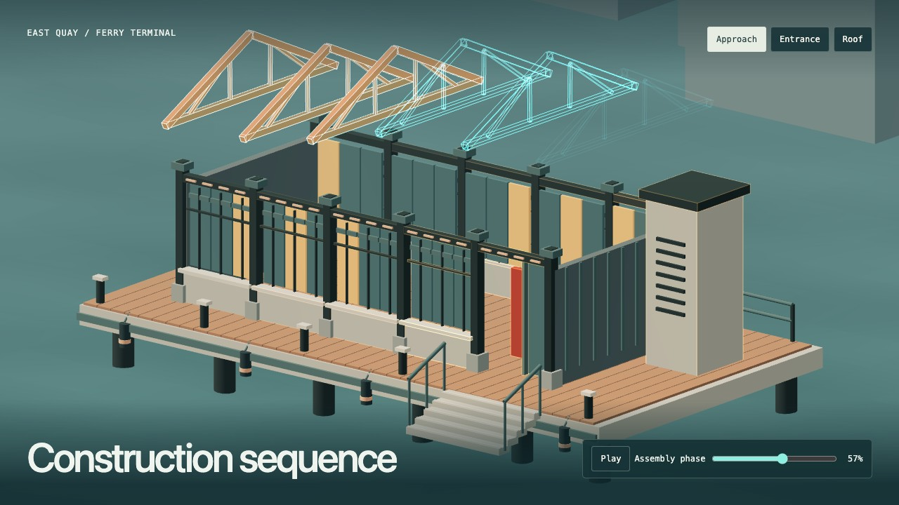](agent-skills/3d/3d-construction-sequence/demo/index.html)

### 3d-feature-objects

Model and light a shelf of instruments that turn independently on hover.

[Open demo](agent-skills/3d/3d-feature-objects/demo/index.html) · [Skill](agent-skills/3d/3d-feature-objects/SKILL.md) · [Prompt](agent-skills/3d/3d-feature-objects/demo/PROMPT.md)

[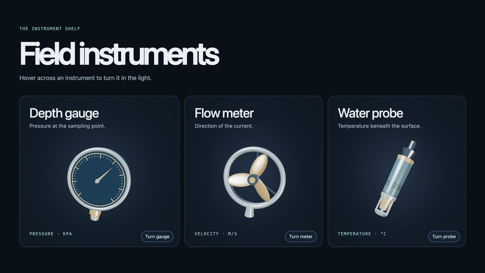](agent-skills/3d/3d-feature-objects/demo/index.html)

### 3d-harbour-water

Reflect quay lights on rain-dappled water, float a launch on the swell and leave a wake through turns.

[Open demo](agent-skills/3d/3d-harbour-water/demo/index.html) · [Skill](agent-skills/3d/3d-harbour-water/SKILL.md) · [Prompt](agent-skills/3d/3d-harbour-water/demo/PROMPT.md)

[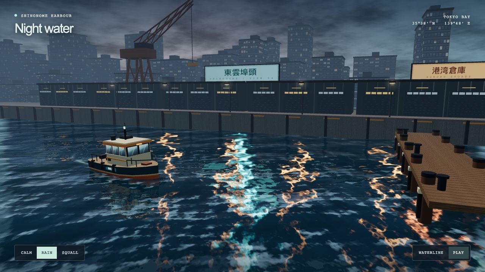](agent-skills/3d/3d-harbour-water/demo/index.html)

### 3d-kasumidera-ultra-realism

Build walkable painterly Three.js environments with warm lacquer, modeled joinery, layered clouds and materials reviewed at 200%.

[Open demo](agent-skills/3d/3d-kasumidera-ultra-realism/demo/index.html) · [Skill](agent-skills/3d/3d-kasumidera-ultra-realism/SKILL.md) · [Prompt](agent-skills/3d/3d-kasumidera-ultra-realism/demo/PROMPT.md)

[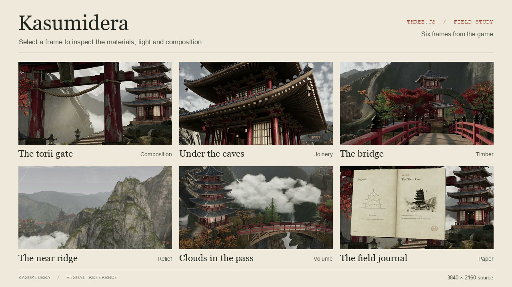](agent-skills/3d/3d-kasumidera-ultra-realism/demo/index.html)

### 3d-modular-buildings

Model structural bays, entrances and rooflines that read from the approach and at eye height.

[Open demo](agent-skills/3d/3d-modular-buildings/demo/index.html) · [Skill](agent-skills/3d/3d-modular-buildings/SKILL.md) · [Prompt](agent-skills/3d/3d-modular-buildings/demo/PROMPT.md)

[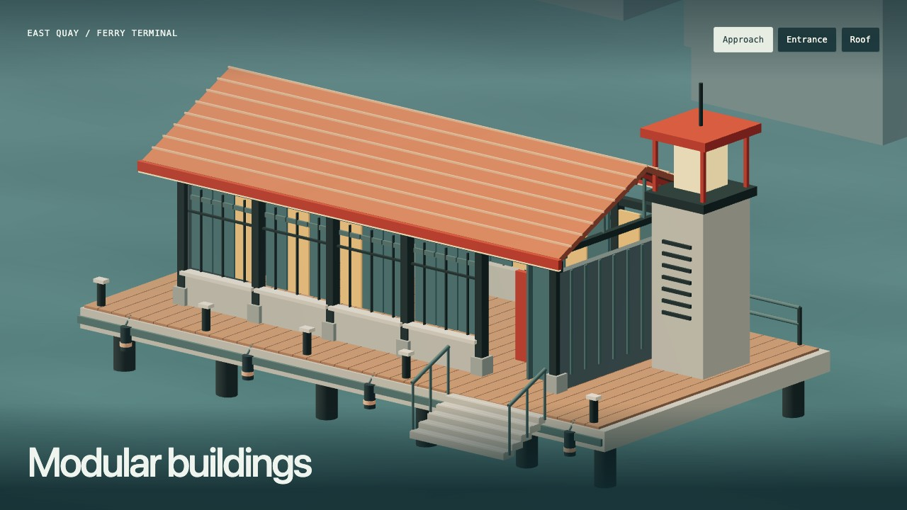](agent-skills/3d/3d-modular-buildings/demo/index.html)

### 3d-survey-scan

Sweep the occupied scene with a cyan pulse that traces its actual mesh edges.

[Open demo](agent-skills/3d/3d-survey-scan/demo/index.html) · [Skill](agent-skills/3d/3d-survey-scan/SKILL.md) · [Prompt](agent-skills/3d/3d-survey-scan/demo/PROMPT.md)

[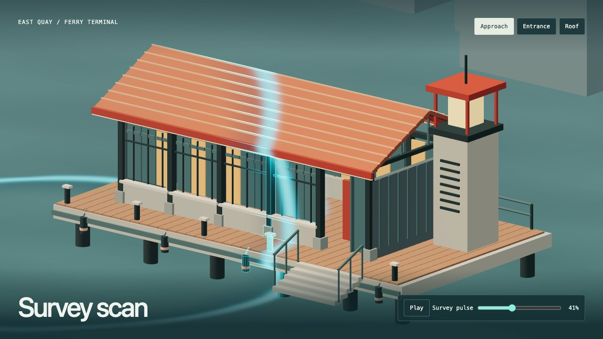](agent-skills/3d/3d-survey-scan/demo/index.html)

### 3d-ultra-realistic-water

Build an ultra-realistic open ocean in Three.js with a deep-water Gerstner spectrum shaded per pixel from analytic derivatives, each wave faded at its own pixel footprint, plus Fresnel sky-cube and planar reflections, subsurface light through the crests, HDR sun glitter, Jacobian lace foam, a Kelvin wake, hull foam, buoyancy queries and aerial perspective into the sky's horizon haze. Use for shallow creeks, water around rocks, seas, oceans, sunset or daylight water, sun glitter paths, ship or boat scenes, wakes, coastal flyovers and any 3D scene with a moving camera and a water horizon. Includes the approved water from Pirate Ship Sunset as a reusable module and demo.

[Open demo](agent-skills/3d/3d-ultra-realistic-water/demo/index.html) · [Skill](agent-skills/3d/3d-ultra-realistic-water/SKILL.md) · [Prompt](agent-skills/3d/3d-ultra-realistic-water/demo/PROMPT.md) · Local demo

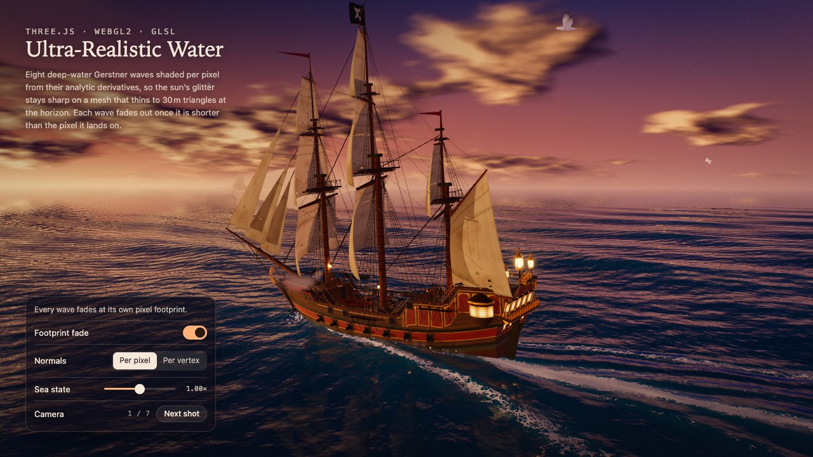

### 3d-underwater-god-rays

Add volumetric underwater god rays to a Three.js scene, marching one drifting swell field along every view ray at half resolution so the light shafts converge on the sun, parallax with the camera and carry rippling caustic streaks, with a shimmering surface underside, a sun that wobbles through the ripples, and the same light dappling fish as they swim through the beams. Use for underwater scenes, oceans seen from below, aquariums, reefs, kelp forests, diving and shipwreck scenes, schools of fish, sunbeams or light shafts through water, caustics, "rays of light shining through the ocean", or watery ripples on a background. Includes a reusable module and the Blue Hour sardine-school demo.

[Open demo](agent-skills/3d/3d-underwater-god-rays/demo/index.html) · [Skill](agent-skills/3d/3d-underwater-god-rays/SKILL.md) · [Prompt](agent-skills/3d/3d-underwater-god-rays/demo/PROMPT.md) · Local demo

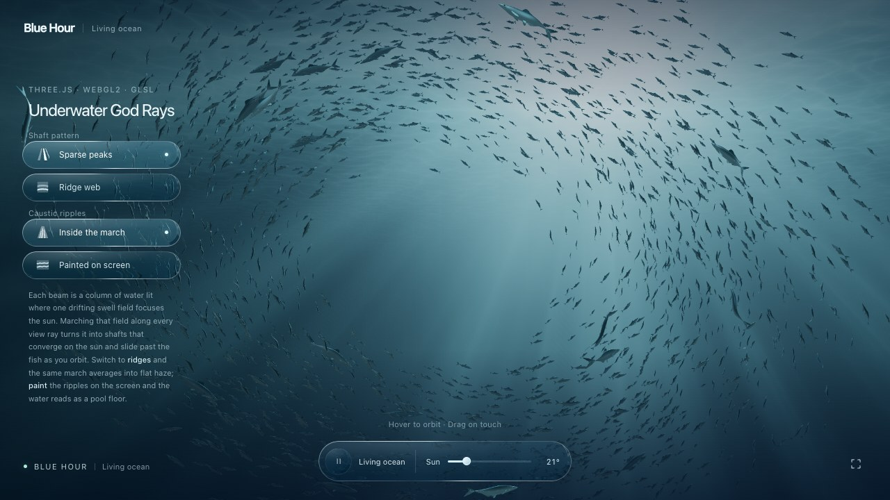

### animate-procedural-birds

Build and animate a small bird in Three.js with a recognizable species silhouette, folding wings, independent head and tail motion, grounded toes and a shadow that holds up in close shots. Use for perching, takeoff, flight and landing in wildlife scenes.

[Open demo](agent-skills/3d/animate-procedural-birds/demo/index.html) · [Skill](agent-skills/3d/animate-procedural-birds/SKILL.md) · [Prompt](agent-skills/3d/animate-procedural-birds/demo/PROMPT.md) · Local demo

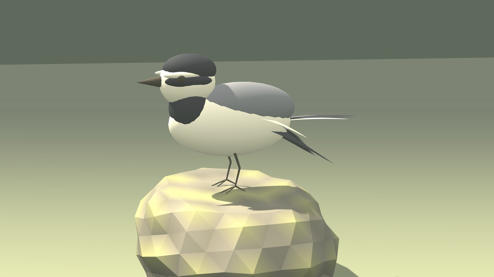

### control-camera-lenses

Add photographic focal length, sensor fit, subject tracking and depth-aware shallow focus to a Three.js scene. Use for lens selectors, dolly and zoom shots, eye focus, and sharp deterministic film exports.

[Open demo](agent-skills/3d/control-camera-lenses/demo/index.html) · [Skill](agent-skills/3d/control-camera-lenses/SKILL.md) · [Prompt](agent-skills/3d/control-camera-lenses/demo/PROMPT.md) · Local demo

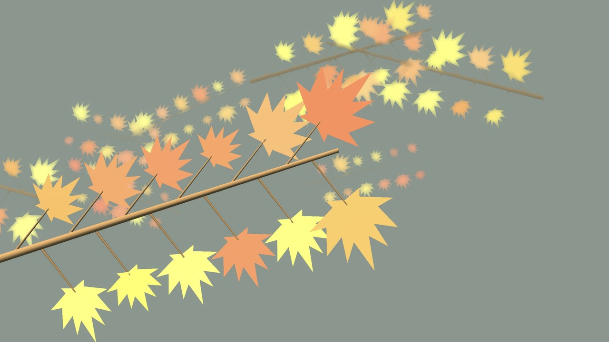

### forest-floor-specimen

Model an animated 3D botanical study with fern fronds, folded pinnae, a moss cushion and grounded stones for a light editorial Journey section.

[Open demo](agent-skills/3d/forest-floor-specimen/demo/index.html) · [Skill](agent-skills/3d/forest-floor-specimen/SKILL.md) · [Prompt](agent-skills/3d/forest-floor-specimen/demo/PROMPT.md)

[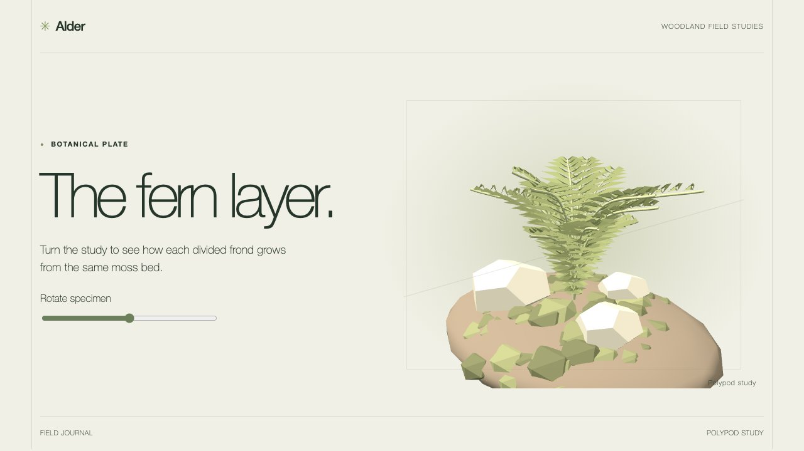](agent-skills/3d/forest-floor-specimen/demo/index.html)

### hover-particle-dissolve

Brush grains off an actual model surface and let them settle back into its silhouette.

[Open demo](agent-skills/3d/hover-particle-dissolve/demo/index.html) · [Skill](agent-skills/3d/hover-particle-dissolve/SKILL.md) · [Prompt](agent-skills/3d/hover-particle-dissolve/demo/PROMPT.md)

[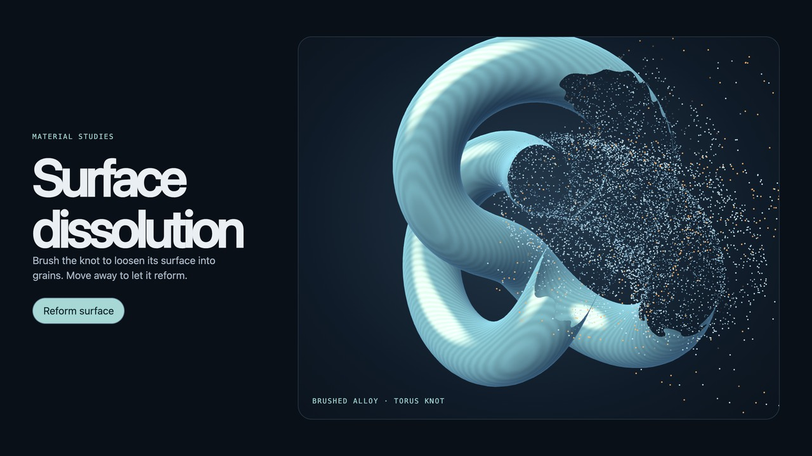](agent-skills/3d/hover-particle-dissolve/demo/index.html)

### interactive-topography

Draw fine contours for a timeline atlas and a raised relief with a press-triggered seismic wave.

[Open demo](agent-skills/3d/interactive-topography/demo/index.html) · [Skill](agent-skills/3d/interactive-topography/SKILL.md) · [Prompt](agent-skills/3d/interactive-topography/demo/PROMPT.md)

[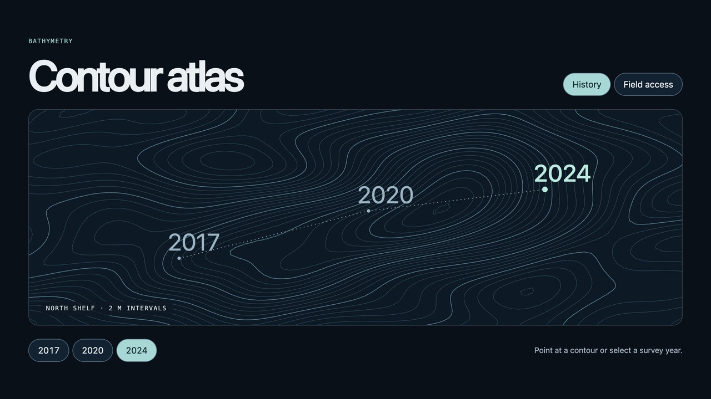](agent-skills/3d/interactive-topography/demo/index.html)

[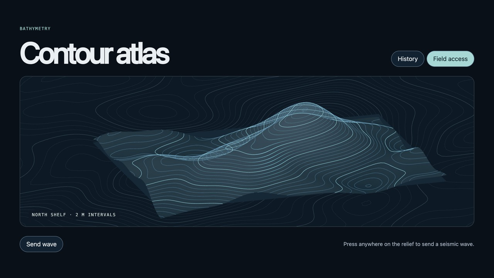](agent-skills/3d/interactive-topography/demo/index.html)

### light-a-threejs-workspace

Build a procedural desk interior with one aperture driving both the blind shadows and volumetric light.

[Open demo](agent-skills/3d/light-a-threejs-workspace/demo/index.html) · [Skill](agent-skills/3d/light-a-threejs-workspace/SKILL.md) · [Prompt](agent-skills/3d/light-a-threejs-workspace/demo/PROMPT.md)

[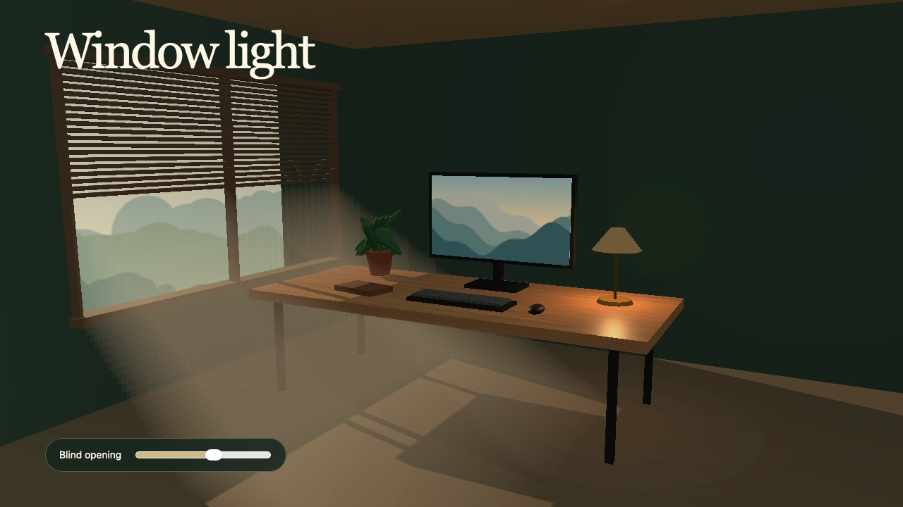](agent-skills/3d/light-a-threejs-workspace/demo/index.html)

### model-threejs-control-icons

Shape, light and render miniature instruments into a reusable high-density atlas.

[Open demo](agent-skills/3d/model-threejs-control-icons/demo/index.html) · [Skill](agent-skills/3d/model-threejs-control-icons/SKILL.md) · [Prompt](agent-skills/3d/model-threejs-control-icons/demo/PROMPT.md)

[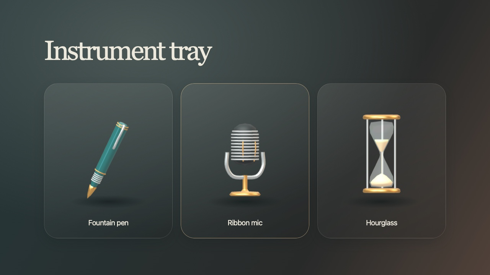](agent-skills/3d/model-threejs-control-icons/demo/index.html)

### perching-butterfly

Animate a small 3D butterfly that banks in flight, approaches an actual plant surface, settles with hinged wings and takes off when disturbed.

[Open demo](agent-skills/3d/perching-butterfly/demo/index.html) · [Skill](agent-skills/3d/perching-butterfly/SKILL.md) · [Prompt](agent-skills/3d/perching-butterfly/demo/PROMPT.md)

[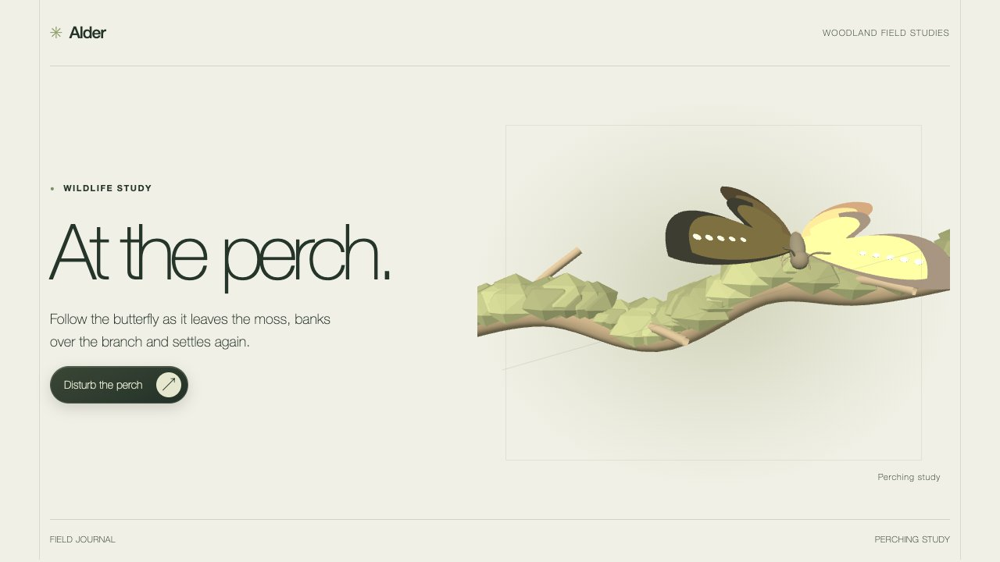](agent-skills/3d/perching-butterfly/demo/index.html)

### relight-painted-surfaces

Steer one studio light across a 2D illustration using separate depth, normal and roughness maps.

[Open demo](agent-skills/3d/relight-painted-surfaces/demo/index.html) · [Skill](agent-skills/3d/relight-painted-surfaces/SKILL.md) · [Prompt](agent-skills/3d/relight-painted-surfaces/demo/PROMPT.md)

[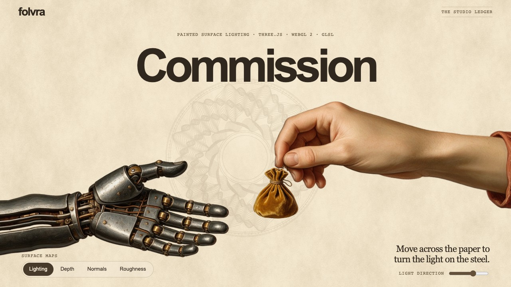](agent-skills/3d/relight-painted-surfaces/demo/index.html)

### woodland-chapter-cameras

Stage a live Three.js valley with a creek, instanced trees and layered fog across a hero, story chapter and footer using distinct scroll-driven camera poses.

[Open demo](agent-skills/3d/woodland-chapter-cameras/demo/index.html) · [Skill](agent-skills/3d/woodland-chapter-cameras/SKILL.md) · [Prompt](agent-skills/3d/woodland-chapter-cameras/demo/PROMPT.md)

[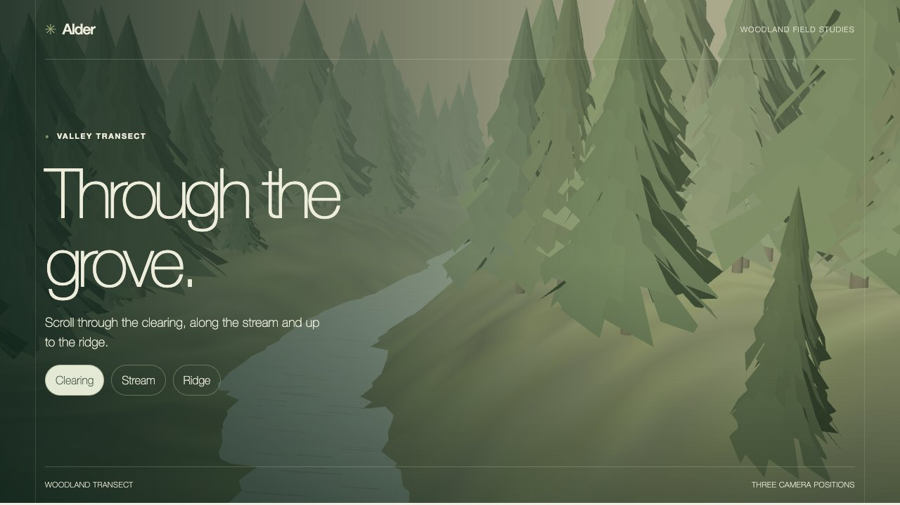](agent-skills/3d/woodland-chapter-cameras/demo/index.html)

## codex (12)

### article-prompts-to-skills

Convert an article, tutorial, or prompt pack into focused reusable AgentSkills, one independent capability per skill, with portable instructions, example prompts, working demos, preview screenshots, validation, gallery updates, and a narrow commit. Use when the user asks to turn an article's prompts, tutorial sections, design patterns, interactions, or workflow ideas into complete skills rather than leaving them as prose.

[Open demo](agent-skills/codex/article-prompts-to-skills/demo/index.html) · [Skill](agent-skills/codex/article-prompts-to-skills/SKILL.md) · [Prompt](agent-skills/codex/article-prompts-to-skills/demo/PROMPT.md) · Local demo

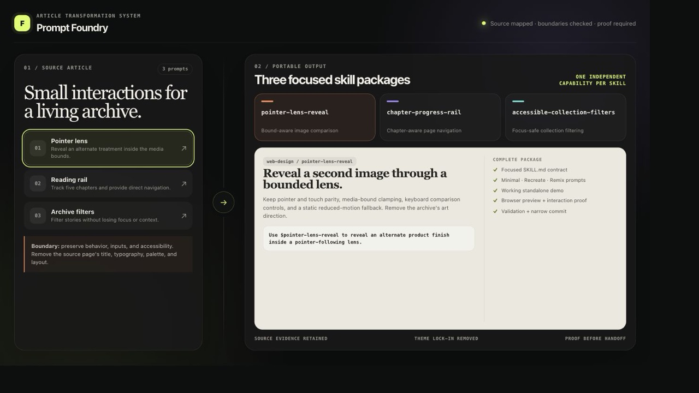

### audit-verify-explain-grade-5

Audit work, verify claims with concrete evidence, and explain the result in simple grade-5 language. Use when the user asks to review, audit, check, verify, explain a change, explain a fix, summarize test results, validate whether something works, or translate technical findings into plain language for non-technical readers.

[Open demo](agent-skills/codex/audit-verify-explain-grade-5/demo/index.html) · [Skill](agent-skills/codex/audit-verify-explain-grade-5/SKILL.md) · [Prompt](agent-skills/codex/audit-verify-explain-grade-5/demo/PROMPT.md) · Local demo

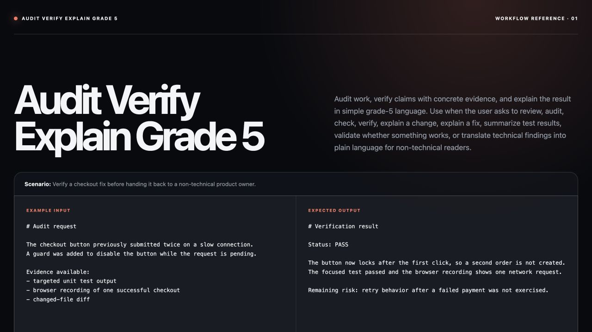

### browser-video-recording

Create polished 60 fps 4:3 4K browser screen-recording style videos from Codex in-app browser captures, with browser-only crop, natural macOS cursor styling, deliberate click choreography, zoom-follow framing, ffprobe/thumbnail verification, and optional native recording compatibility checks. Use when the user asks to record or re-record browser actions, show cursor clicks and zooms, make Dribbble/UI inspiration or product demo recordings, or asks whether Codex, Playwright, or an MCP can produce a natural browser demo video.

[Open demo](agent-skills/codex/browser-video-recording/demo/index.html) · [Skill](agent-skills/codex/browser-video-recording/SKILL.md) · [Prompt](agent-skills/codex/browser-video-recording/demo/PROMPT.md) · Local demo

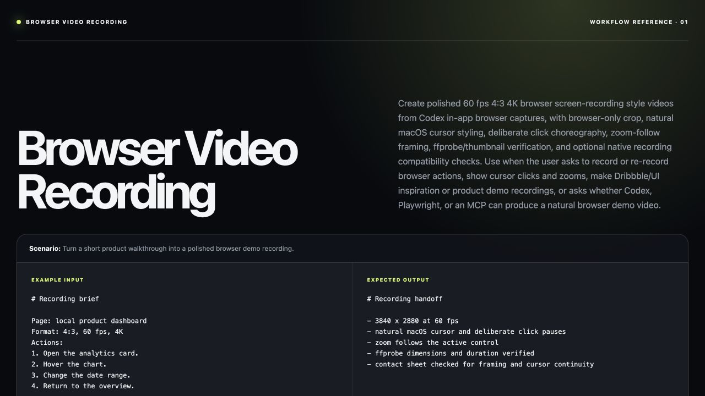

### daily-ui-inspiration-capture

Create a recurring daily UI inspiration capture. Use when the user asks to run, refresh, package, or validate dated UI inspiration bundles, especially for `articles/YYYY-MM-DD-ui-inspiration-capture/` outputs, Framer/Dribbble landing-page inspiration, motion-study screenshots/videos, AI-builder prompts, duplicate checking, or converting a project runbook into repeatable workflow.

[Open demo](agent-skills/codex/daily-ui-inspiration-capture/demo/index.html) · [Skill](agent-skills/codex/daily-ui-inspiration-capture/SKILL.md) · [Prompt](agent-skills/codex/daily-ui-inspiration-capture/demo/PROMPT.md) · Local demo

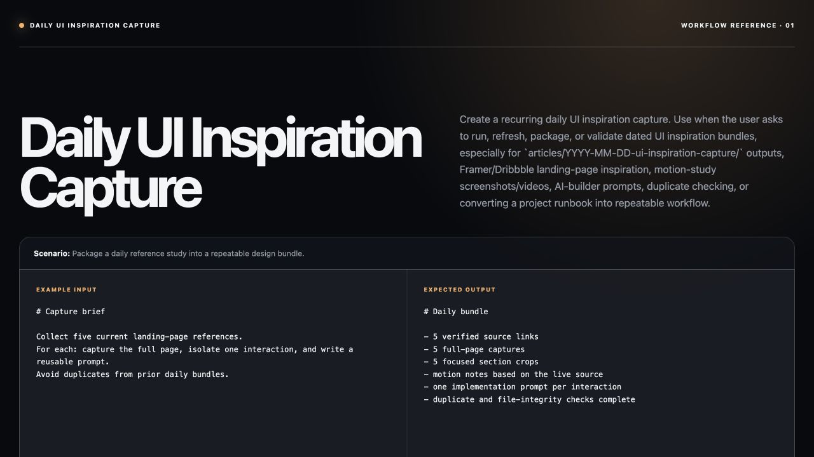

### elevenlabs-tts

Generate ElevenLabs text-to-speech audio from scripts or inline text using local voice profiles. Use when the user asks for ElevenLabs, text-to-speech, TTS, narration, voiceover, speech audio, or voice generation; load voice names, voice ids, emails, owners, and account-specific defaults only from local config outside the skill.

[Open demo](agent-skills/codex/elevenlabs-tts/demo/index.html) · [Skill](agent-skills/codex/elevenlabs-tts/SKILL.md) · [Prompt](agent-skills/codex/elevenlabs-tts/demo/PROMPT.md) · Local demo

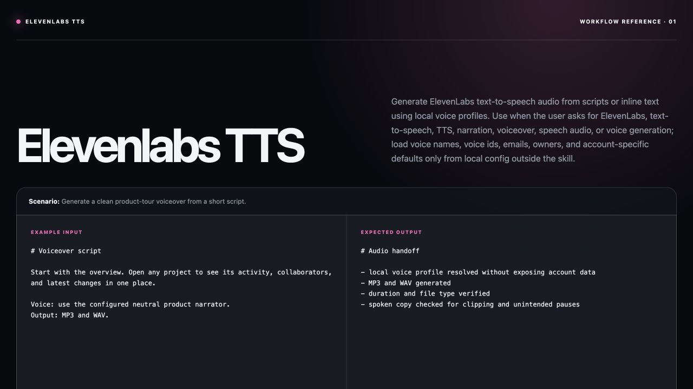

### html-to-interaction-prompts

Convert a supplied HTML page or generated HTML reference into a screenshot-backed article containing multiple reusable interaction prompts. Use when the user provides an HTML file, exported page, generated-page.html, or local/live reference and asks to extract animation/interactions, create prompts, capture screenshots for each prompt, add them to an article, or commit the resulting article/assets.

[Open demo](agent-skills/codex/html-to-interaction-prompts/demo/index.html) · [Skill](agent-skills/codex/html-to-interaction-prompts/SKILL.md) · [Prompt](agent-skills/codex/html-to-interaction-prompts/demo/PROMPT.md) · Local demo

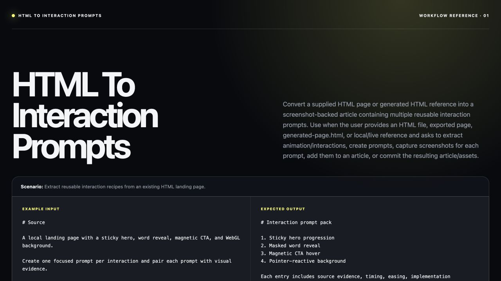

### optimize-web-animations

Profile, audit, and optimize frontend page performance with emphasis on animation work, memory-leak risks, long-session slowdowns, CSS animations, canvas/WebGL requestAnimationFrame loops, marquees, skeletons, GSAP/Three/Matter effects, timers, listeners, and observers. Use when the user asks to make animations performant, pause offscreen animations, look for memory leaks, profile pages that slow the computer over time, fix janky scrolling, reduce CPU/GPU use, or repeat the "only play in view" optimization on React/Vite/Next/frontend pages using Codex Browser.

[Open demo](agent-skills/codex/optimize-web-animations/demo/index.html) · [Skill](agent-skills/codex/optimize-web-animations/SKILL.md) · [Prompt](agent-skills/codex/optimize-web-animations/demo/PROMPT.md) · Local demo

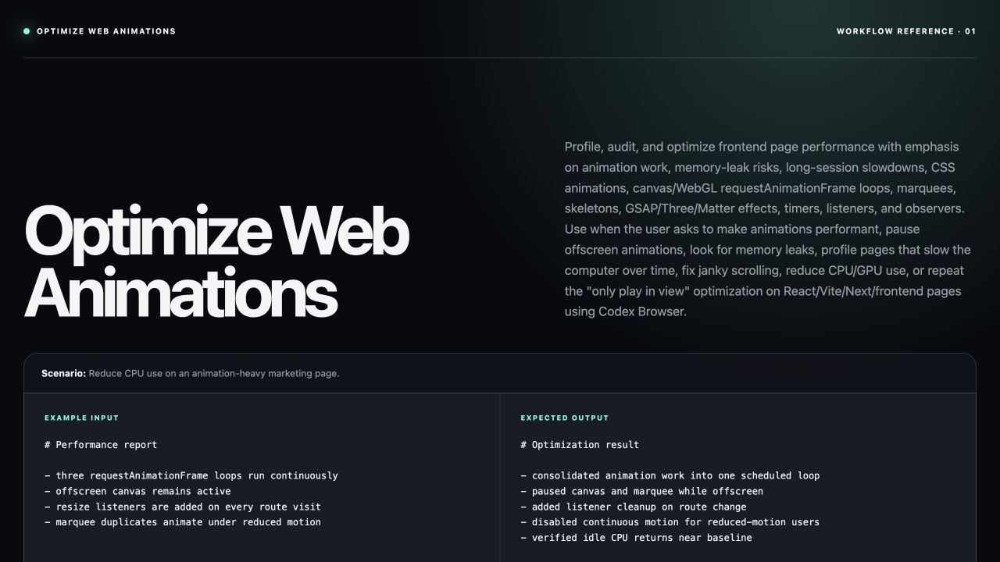

### performance-profiling

Guide performance profiling for Apple platform apps with Instruments, Xcode diagnostics, and MetricKit. Use when investigating app hangs, stutters, high CPU, memory leaks, memory growth, OOM crashes, slow launch, battery drain, thermal issues, App Store performance readiness, or when adding os_signpost and measurement hooks.

[Open demo](agent-skills/codex/performance-profiling/demo/index.html) · [Skill](agent-skills/codex/performance-profiling/SKILL.md) · [Prompt](agent-skills/codex/performance-profiling/demo/PROMPT.md) · Local demo

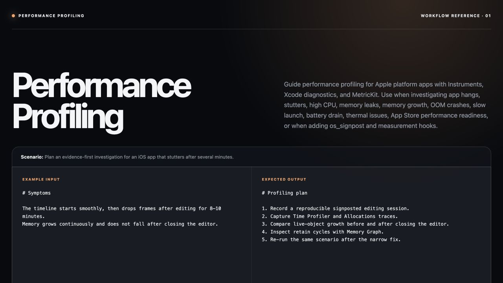

### stitched-full-page-capture

Capture or repair reliable full-page screenshots for lazy-loaded, scroll-animated, Framer, WebGL/canvas, or reveal-heavy web pages. Use when full-page screenshots are blank, gray, white, sparse, show a tiny content strip, disagree with a working scroll video, or when article evidence/section crops must be derived from a trustworthy full-page image.

[Open demo](agent-skills/codex/stitched-full-page-capture/demo/index.html) · [Skill](agent-skills/codex/stitched-full-page-capture/SKILL.md) · [Prompt](agent-skills/codex/stitched-full-page-capture/demo/PROMPT.md) · Local demo

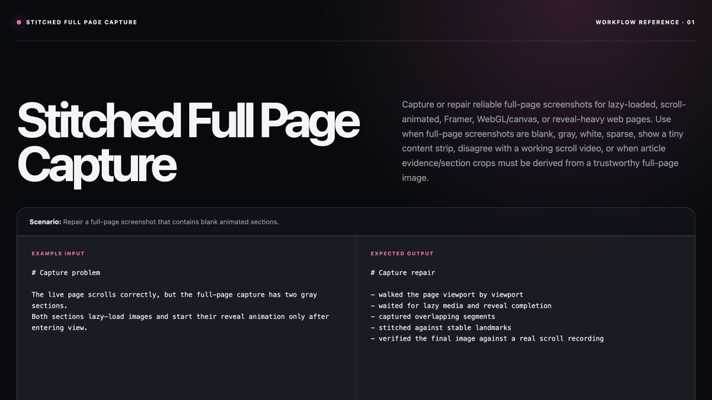

### video-to-superprompt

Turn a reference video into a super detailed recreation or inspiration prompt. Use when the user provides, mentions, uploads, links, or points to a video and asks to analyze the design, UI, animations, transitions, scroll interactions, typography, colors, assets, WebGL/Three.js, storytelling, section-by-section behavior, or to create a prompt/article that recreates the page, app, interaction, or motion system.

[Open demo](agent-skills/codex/video-to-superprompt/demo/index.html) · [Skill](agent-skills/codex/video-to-superprompt/SKILL.md) · [Prompt](agent-skills/codex/video-to-superprompt/demo/PROMPT.md) · Local demo

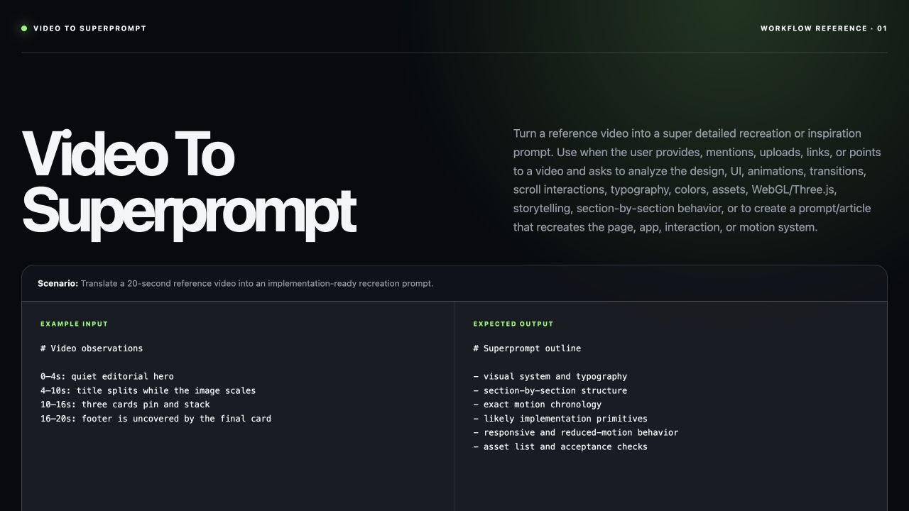

### web-technique-to-skill

Turn a visual or interaction technique you already built into a reusable web-design skill, by isolating the one mechanism that makes it work while reproducing its approved reference exactly around that focus, and packaging it with a demo that proves both the mechanism and the visual fidelity. Covers finding the mechanism, naming the technique plainly, disclosing the verified runtime and renderer, auditing reference layers, carrying real numbers instead of adjectives, preserving owned staging, keeping expensive gotchas, declaring the boundary against neighbouring skills, and browser-verifying before claiming it works. Use when a page, canvas scene, shader, scroll effect, layout system, or hover interaction turned out well and should become a skill rather than staying in one project.

[Open demo](agent-skills/codex/web-technique-to-skill/demo/index.html) · [Skill](agent-skills/codex/web-technique-to-skill/SKILL.md) · [Prompt](agent-skills/codex/web-technique-to-skill/demo/PROMPT.md) · Local demo

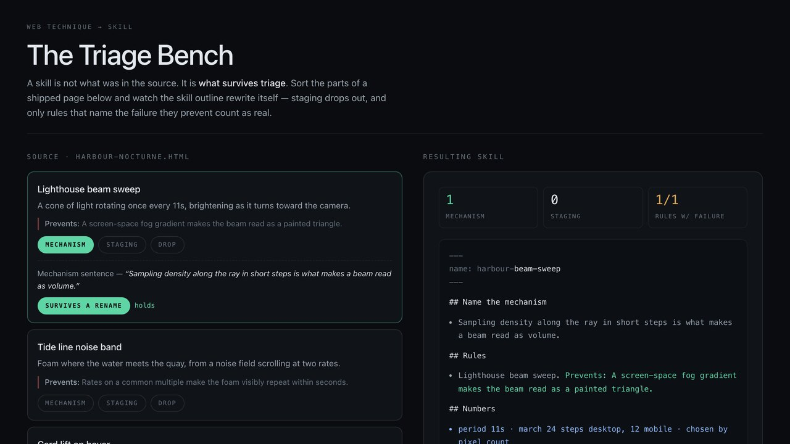

### x-bookmark-quote-posts

Check a user's latest X/Twitter bookmarks and turn recent saved posts into source-backed quote-post drafts calibrated against the user's latest 100 authored posts. Use when asked to review X bookmarks, create quote posts from bookmarks, refresh a bookmark quote queue, run a bookmark quote automation, study a user's X voice, or write first-person quote posts from X sources.

[Open demo](agent-skills/codex/x-bookmark-quote-posts/demo/index.html) · [Skill](agent-skills/codex/x-bookmark-quote-posts/SKILL.md) · [Prompt](agent-skills/codex/x-bookmark-quote-posts/demo/PROMPT.md) · Local demo

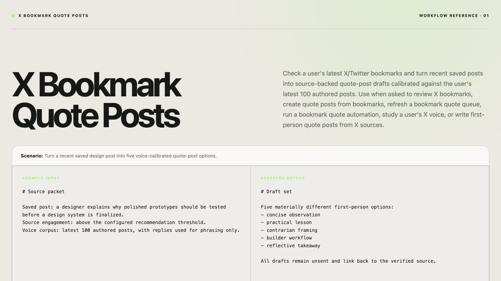

## game-combat (4)

### fire-smoke-skill-vfx

Build the effects of a fire skill as one visual language in Three.js. Flames that read as fire, not as orange fog or cones: ray-marched flame volumes whose turbulence rises with buoyancy (slow at the root, accelerating and stretching as it climbs) instead of scrolling, a temperature ramp from a white-hot core a little above the fuel through yellow and orange to deep red tips, broad brighter licks inside, walls of fire broken into clumps of separate tongues of very different heights with notches between them and licks that detach and go out, a fire whirl wound in helical sheets with a waist and a blue root; charcoal smoke drawn premultiplied over the frame and lit only by the fire (cauliflower billows for a burst, a thin streaked curtain off a grass-fire front, fibrous wisps off small fires, ragged hot cracks inside a burst's smoke); embers and sparks that drift on a curl field, cool from white through orange to red and fall as ash; heat haze as refraction; firelight shared with the world; a world-space heat map that makes the ground's needles smoulder as hairlines and its pockets breathe; and gentle ink impact frames limited to three flashes a second. Use for fire or flame skills, fireballs, fire waves or breath, rings of fire, fire tornadoes or whirls, burning ground, wildfire fronts, smoke columns, embers, smouldering aftermath, "fire and smoke", "realistic fire", "flame thrower", "inferno", "burning field" or "skill effects only". Includes a reusable module and a five-beat demo on a scanned CC0 burned-ground floor with failure-mode switches.

[Open demo](agent-skills/game-combat/fire-smoke-skill-vfx/demo/index.html) · [Skill](agent-skills/game-combat/fire-smoke-skill-vfx/SKILL.md) · [Prompt](agent-skills/game-combat/fire-smoke-skill-vfx/demo/PROMPT.md) · Local demo

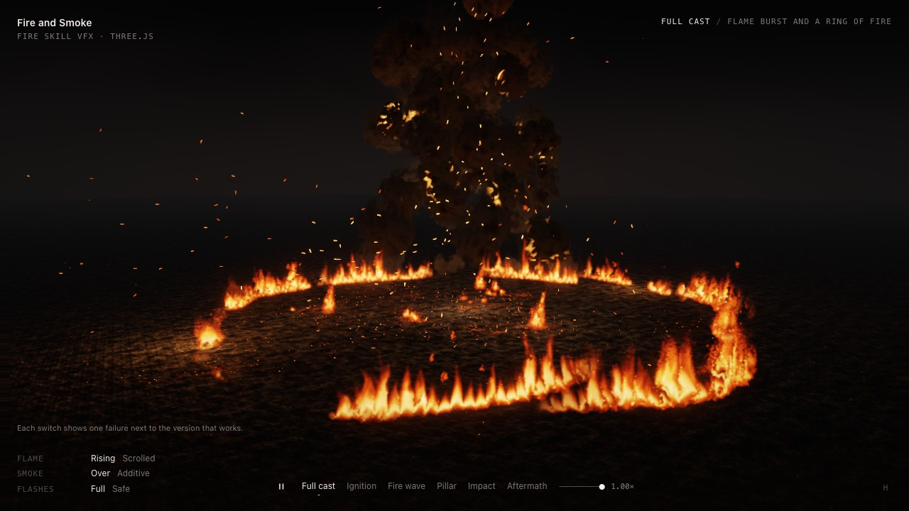

### ice-frost-skill-vfx

Build the effects of an ice and frost skill as one visual language in Three.js. Frost that grows like real frost, not a painted fern: a dendritic tree grown on the CPU from a seed point, stems racing outward with barbs and sub-barbs that compete for space in one time-ordered queue, side branches leaned toward their tips, baked into a distance field so the shader draws hairline feathers growing out from the seed with a bright tip, rime, crystal glints and a contact shadow. Faceted ice spikes built from half-spaces and ray-traced against their own planes (Snell, Fresnel, total internal reflection, Beer-Lambert blue, trapped bubbles, a fracture network, frosted edges) that erupt along the frost line, crack along visible planes and shatter into convex pieces that tumble, land on a face and rest, with snow lumps and ice chips settled into the crust. A low freezing mist marched as wind-stretched banks that churn in place and part around the ice, a blizzard column of powder on helical strands with a fibrous veil, glinting diamond dust, and a scanned snow floor with dunes, broken crust, a raking moon with self-shadow and two populations of glints. Use for ice or frost skills, frost novas, ice spikes or walls, glacial eruptions, shattering ice, blizzards, snow devils, freezing mist, frozen ground, "ice and frost", "frost creep", "ice shards", "realistic ice" or "skill effects only". Includes two reusable modules and a five-beat demo on a scanned CC0 snow floor with a failure-mode switch.

[Open demo](agent-skills/game-combat/ice-frost-skill-vfx/demo/index.html) · [Skill](agent-skills/game-combat/ice-frost-skill-vfx/SKILL.md) · [Prompt](agent-skills/game-combat/ice-frost-skill-vfx/demo/PROMPT.md) · Local demo

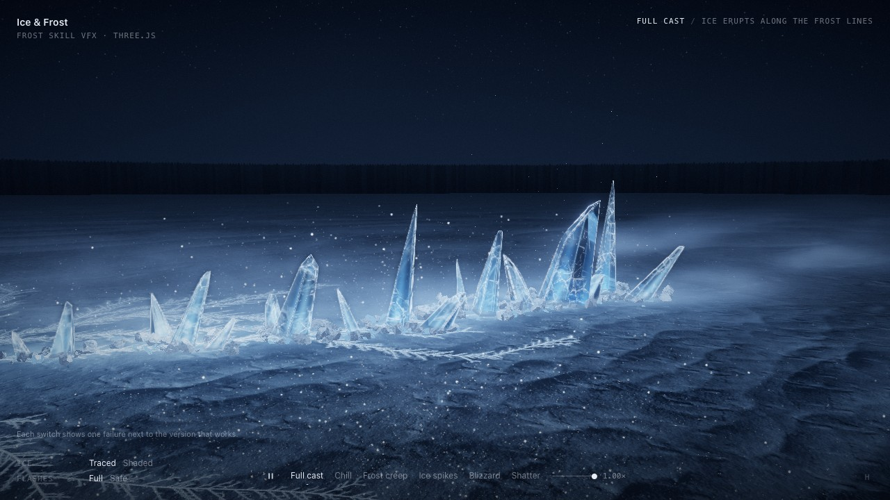

### lightning-energy-skill-vfx

Build the effects of a close-combat energy skill as one visual language in Three.js. Lightning that reads as lightning, dynamic but never in your face: trees of strips (trunk, forks of forks, hair-fine branchlets) with a fine white core in a violet-blue glow, each channel reaching out as a stepped leader, flaring as it connects, holding its shape and fading through an afterglow, one discharge at a time; a storm-cloud orb (a lit billow surface that churns in place, 10-15 plasma-globe arcs from a small white core to its inner wall, crawlers on the rim, a hairline fresnel); ground strikes that flash when the leader arrives, crawl along the stone's own cracks and reflect in wet stone (the demo's floor is a scanned CC0 texture); a torn black shadow with dry-brush edges that hangs off the orb and streams behind it, air bursts felt as refraction, orange sparks, fractured rocks that land or float in a storm domain, and impact frames that hold, invert in two-tone ink with tapered speed lines, shake and bend the lens, limited to three flashes a second. Use for anime or dark-fantasy skill effects, lightning or thunder fists, plasma or energy balls, charge-ups, dashes with shadow trails, ground strikes, storm or domain rings, ultimates, hit-stop, impact frames, negative flashes, screen shake, "black lightning", "thunderstorm fist", "realistic lightning", "afterimage" or "skill effects only". Includes a reusable module and a five-beat demo with failure-mode switches.

[Open demo](agent-skills/game-combat/lightning-energy-skill-vfx/demo/index.html) · [Skill](agent-skills/game-combat/lightning-energy-skill-vfx/SKILL.md) · [Prompt](agent-skills/game-combat/lightning-energy-skill-vfx/demo/PROMPT.md) · Local demo

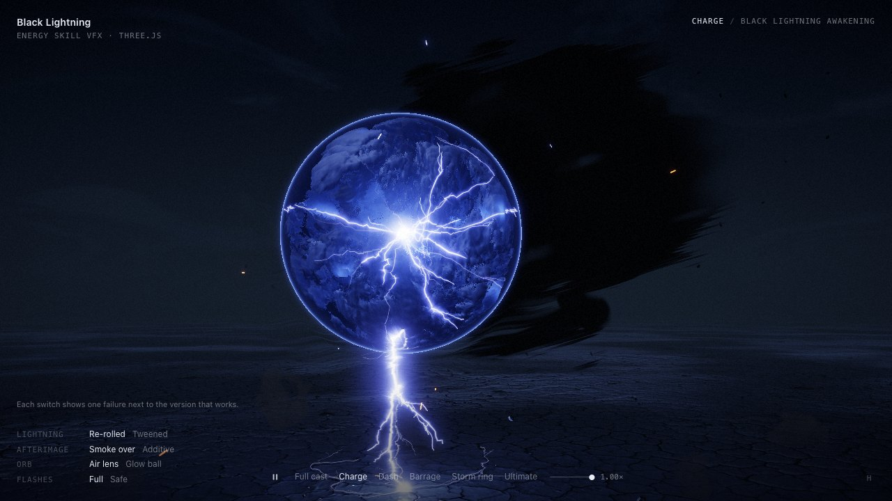

### water-crystal-skill-vfx

Build the effects of a water and crystal skill as one visual language in Three.js. Water that reads as clear water, never a teal fill or a textured ball. A ray-marched water orb whose surface swells, rings and deforms in place: it refracts the frame behind it with an inverted horizon, has a silver rim and sharp highlights, and shows a faint caustic web on its far wall. Streams wound up from tide pools as uneven beaded ropes with silver edges, drips and shed drops. A lash that unspools from the orb, whips and pours into a pool under a torn, lopsided splash crown of aerated white water with spikes breaking into drops. Analytic ripple rings and rain on the pools. Crystals traced against their own half-space planes (Snell, Fresnel, total internal reflection, exit dispersion, Beer–Lambert, fracture discs, a white-hot root glow and a resonance band that climbs the stone), growing out of the water in a draining veil, then shattering into Voronoi shards that fall, tumble and rest with real contact on a heightfield. Caustics on the pool floor, and a moonlit tidal rock flat: rock banks traced from target images onto a world grid, flat mirror pools, a moon-glitter column of micro-facet glints, and a moon disc with maria. Use for water or ice-crystal skills, water orbs or bubbles, water whips, jets or tentacles, splash impacts, tide pools, rain, crystal growth or eruption, crystal resonance, shattering glass or quartz, caustics, wet-stone night scenes, moon reflections on water, "water and crystal", "hydro", "clear water VFX", "crystal shatter" or "skill effects only". Includes a reusable module and a five-beat demo on a scanned CC0 low-tide floor with failure-mode switches.

[Open demo](agent-skills/game-combat/water-crystal-skill-vfx/demo/index.html) · [Skill](agent-skills/game-combat/water-crystal-skill-vfx/SKILL.md) · [Prompt](agent-skills/game-combat/water-crystal-skill-vfx/demo/PROMPT.md) · Local demo

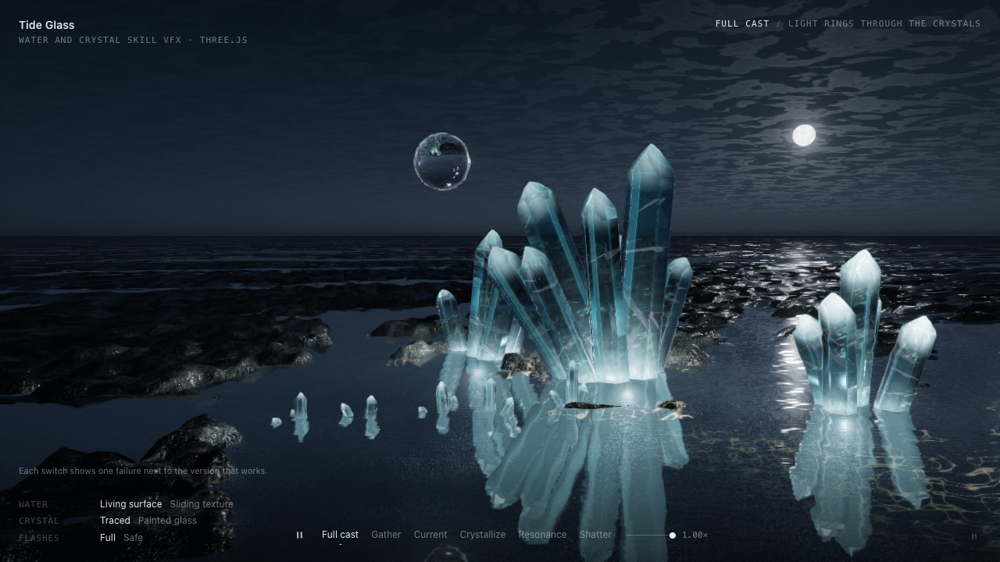

## game-development (1)

### game-dev-character-model

Create a realistic, AAA-looking 3D character model for a game or web scene, from a description or a reference video/image, as a textured, rigged GLB standing in a relaxed pose in a lit three.js viewer. Covers designing an original character, the photoreal A-pose concept image, image-to-3D with Meshy or Tripo through Fil, rigging, posing in code, hangar-style lighting, headless capture, and the checks before showing it. Use when the user asks for a character model, a hero/heroine/NPC, "a model as good as X", a realistic human for a game, or to rig or pose a generated character.

[Open demo](agent-skills/game-development/game-dev-character-model/demo/index.html) · [Skill](agent-skills/game-development/game-dev-character-model/SKILL.md) · [Prompt](agent-skills/game-development/game-dev-character-model/demo/PROMPT.md) · Local demo

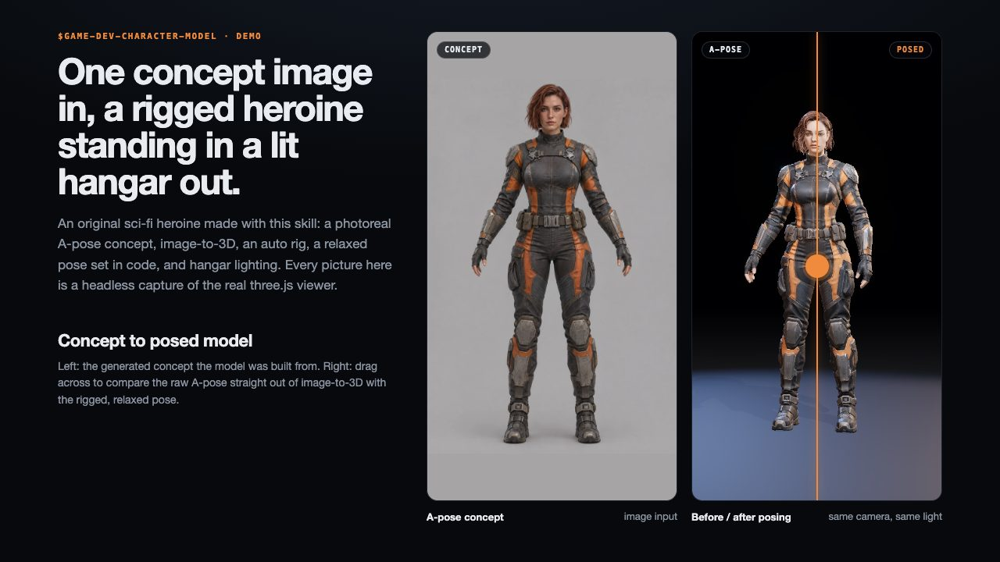

## illustration (14)

### illustration-bold-pop

Draws hand-authored SVG spot illustrations in a bold pop-geometric style for design and coding scenes. Identifying traits: a thick navy outline on every shape, solid navy extrusions that always step down-right, saturated flat fills (hot pink, lemon, aqua, violet, mint, lime) textured with navy hatching and dots, and a dense overlapping cluster of chunky props (browser windows, pinwheel tiles, iso cubes, lightning bolts) around one slim cartoon character. Covers palette, line weights, extrusion and union-outline techniques, a JS helper for the repeated marks, characters and hands, composition and a render-and-critique loop. Use when someone asks for bold pop, pop geometric, retro pop, memphis-style, navy-outline, chunky outlined or loud colourful illustrations, or for empty states, onboarding, 404 or error pages, blog headers, feature spots and marketing cards in that look.

[Open demo](agent-skills/illustration/illustration-bold-pop/demo/index.html) · [Skill](agent-skills/illustration/illustration-bold-pop/SKILL.md) · [Prompt](agent-skills/illustration/illustration-bold-pop/demo/PROMPT.md) · Local demo

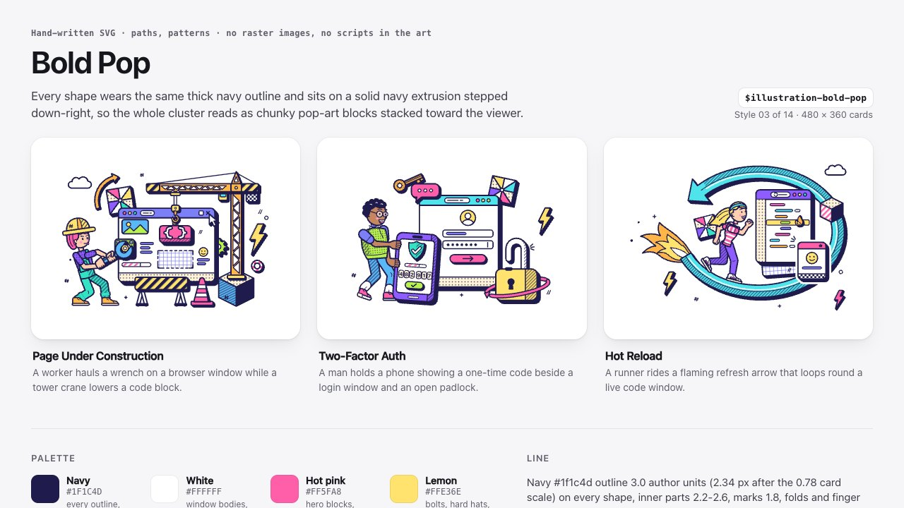

### illustration-flat-with-black

Draws flat vector spot illustrations of tall, long-legged people doing design and coding things, with solid black as a main colour. Traits: no outlines on coloured fills; black as big solid shapes (hair, trousers, shoes, devices) and as thin detail lines; denim blue, leaf green, sun yellow and tomato red on cream skin; dot eyes, round glasses and blush; big shoes on one thin black ground line; two stars and two plus-sparkles as the only decor. Covers palette, line weights, characters, heads, hands, props, composition and a parts helper for limbs, shoes, heads, hands and paper props. Use when someone asks for flat illustration with black, flat people or character illustration, friendly product or SaaS illustration, or art for empty states, onboarding, 404 and error pages, blog headers, feature spots, marketing cards or app screens in this style.

[Open demo](agent-skills/illustration/illustration-flat-with-black/demo/index.html) · [Skill](agent-skills/illustration/illustration-flat-with-black/SKILL.md) · [Prompt](agent-skills/illustration/illustration-flat-with-black/demo/PROMPT.md) · Local demo

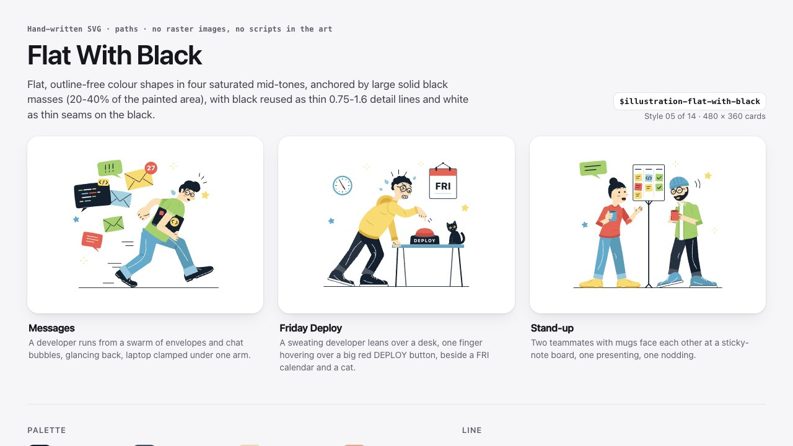

### illustration-flat

Draws flat vector illustrations as SVG cards (480x360): slim, long-limbed people acting out one design or coding moment with one hero prop. Identified by no outlines on big shapes, thin white fold strokes as the only shading, navy only for hair, sneakers and a few hairlines, small heads (about 1:7) with big hands and white sneakers, and sparse floating confetti with no ground line, in lavender, indigo, sunshine yellow, coral and mint. Covers the measured palette, stroke numbers, character construction (tapered limbs, separated fingers, thumb side), poses, props, composition and a tested parts kit. Use when asked for flat illustrations, flat vector people, outline-free or no-outline characters, modern or corporate flat art, empty states, onboarding screens, 404 or error pages, coming-soon pages, blog headers, feature spots or marketing cards.

[Open demo](agent-skills/illustration/illustration-flat/demo/index.html) · [Skill](agent-skills/illustration/illustration-flat/SKILL.md) · [Prompt](agent-skills/illustration/illustration-flat/demo/PROMPT.md) · Local demo

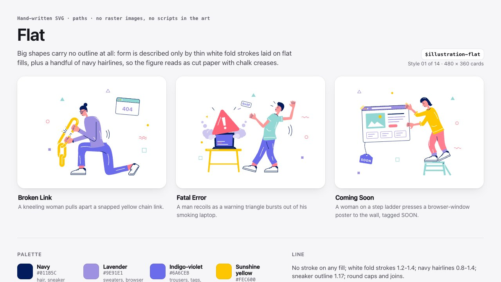

### illustration-framed-panel

Draws original design-and-coding scenes as SVG cards (480x360) in a framed-panel cartoon style. Identifying traits are a soft pastel card with a periwinkle-violet panel framed in thin navy, outline-only clouds and a pale lavender floor band with dashes inside it; L-shaped corner brackets outside two corners; white speech bubbles, UI cards and bushes that break out over the frame edge; and a semi-real character with a thin navy outline (1.25 px), muted flat fills, navy hair with violet highlights, blush and short paired hatch marks. Covers people working with laptops, screens, UI parts and devices. Use when someone asks for a framed panel, window-frame or picture-frame illustration, pastel violet cartoon, outlined flat character scene, empty-state, onboarding or 404 art, a blog header, a feature spot, a support, about or team page illustration, or a marketing card with a person.

[Open demo](agent-skills/illustration/illustration-framed-panel/demo/index.html) · [Skill](agent-skills/illustration/illustration-framed-panel/SKILL.md) · [Prompt](agent-skills/illustration/illustration-framed-panel/demo/PROMPT.md) · Local demo

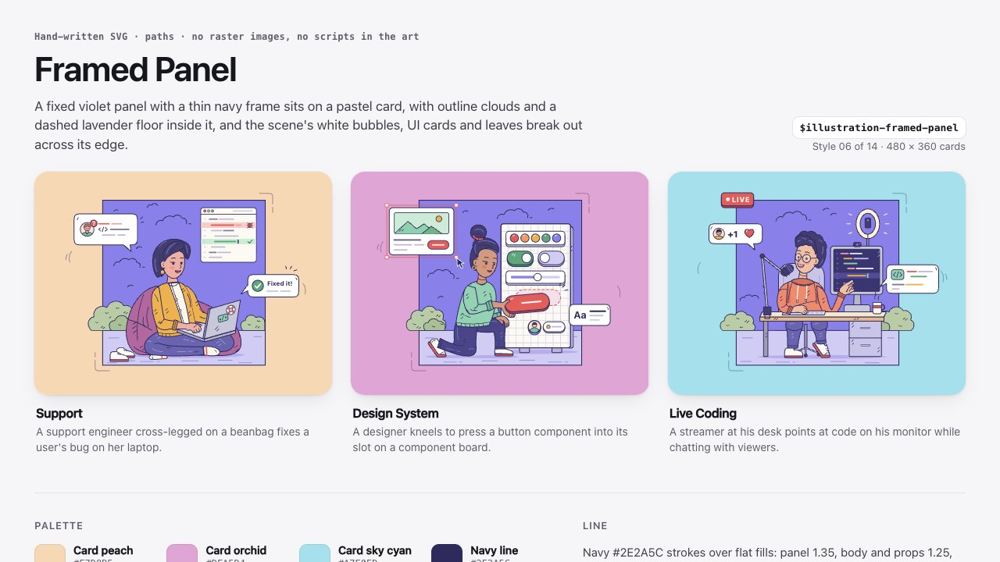

### illustration-grainy-gouache

Draws original cosy animal scenes as hand-authored SVG cards (480x360) in a grainy gouache, risograph-like style. Identifying traits are flat shapes with no outlines on a hot-pink card; soft 3-4 stop gradient shading on every rounded form, darker toward edges and base; a fine dark multiply grain that gathers at each shape's edges; a chalky purple-pink shadow pooled under the group; and big glossy eyes with cream star highlights, framed by grained autumn leaves and sparse cream sparkles. It covers design and coding moments with one cute animal at a laptop, monitor, desk, window, mug or book stack. Use when someone asks for grainy, gouache, riso, risograph, textured, cosy, cozy, autumn, hygge, storybook or children's-book style animal art, or for an empty state, onboarding step, 404 page, blog header, feature spot or marketing card with a warm handmade feel.

[Open demo](agent-skills/illustration/illustration-grainy-gouache/demo/index.html) · [Skill](agent-skills/illustration/illustration-grainy-gouache/SKILL.md) · [Prompt](agent-skills/illustration/illustration-grainy-gouache/demo/PROMPT.md) · Local demo

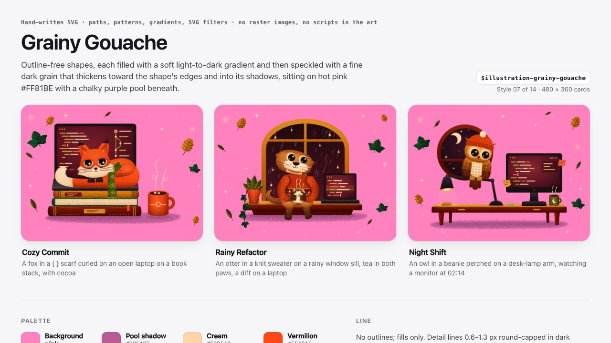

### illustration-halftone-line

Draws hand-authored SVG spot illustrations in a halftone line style for design and coding scenes. Identifying traits are a confident black line with a slight hand wobble and contours left open, grey tones made only of fine halftone dots clipped to shapes, a few solid black masses (hair, leaves, a bag, a black tee), warm off-white paper and no colour at all. Covers the two-ink palette, line weights, the open-contour and stipple techniques, a seeded compiler that turns tone tags into dot fills, rubbery long-limbed characters and expressive hands, doodles, floor pools and a render-and-critique loop. Use when someone asks for halftone, stipple, dotted, risograph-like, newsprint, black-and-white, monochrome line, editorial line or zine-style illustrations, or for empty states, onboarding, 404 pages, blog headers, feature spots and marketing cards in that look.

[Open demo](agent-skills/illustration/illustration-halftone-line/demo/index.html) · [Skill](agent-skills/illustration/illustration-halftone-line/SKILL.md) · [Prompt](agent-skills/illustration/illustration-halftone-line/demo/PROMPT.md) · Local demo

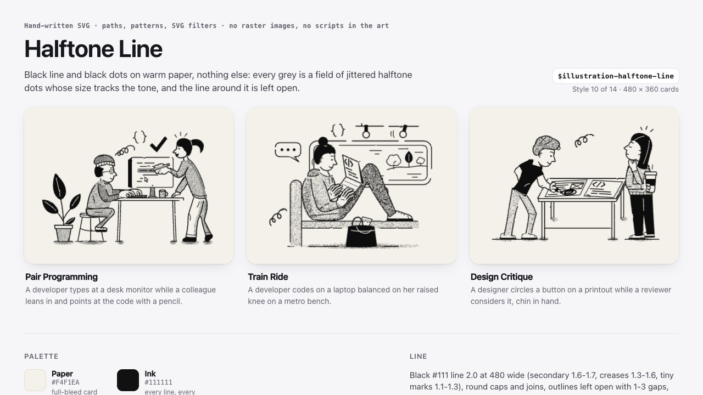

### illustration-ink-sketch

Draws hand-inked cartoon critters and living objects as SVG cards (480x360), each acting out a coding or design idea. Identified by thick black brush-pen outlines that swell and taper and break into separate strokes, loose marker-and-watercolour fills that slip past the line, diagonal hatching instead of solid shadow, huge googly eyes with two specular dots, and stray ink hairs and flecks, in tomato red, leaf green, sunflower yellow, sky blue and teal on white. Covers palette, brush numbers, mascot construction (eyes, blush, mouths, 3-finger hands), props, ground patches and a tested, seeded brush kit. Use when asked for ink sketch, hand-drawn, brush pen, sketchy, doodle, marker or watercolour-cartoon illustrations, googly-eyed mascots or critters, playful empty states, onboarding, 404 or error pages, loading states, blog headers, feature spots or marketing cards.

[Open demo](agent-skills/illustration/illustration-ink-sketch/demo/index.html) · [Skill](agent-skills/illustration/illustration-ink-sketch/SKILL.md) · [Prompt](agent-skills/illustration/illustration-ink-sketch/demo/PROMPT.md) · Local demo

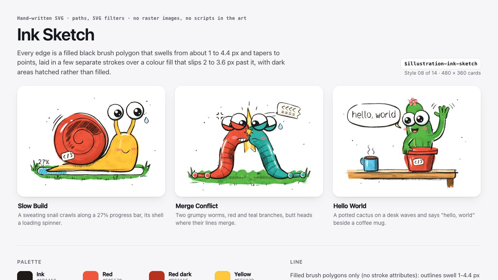

### illustration-isometric-mono

Draws true-isometric diorama illustrations of developer and design workspaces in one green ramp, generated as SVG with a bundled scene kit. Traits: one rounded off-white slab with a faceted bevelled edge; every face filled by the way it faces (top lightest, right darkest) from five greens; 0.9 deep-green outlines on every edge; dense fine repeated detail (rack units, ribs, vents, keys, code lines); soft green shadows and glows on the slab. Covers projection, shading, line weights, object vocabulary, layout and the iso.mjs kit (racks, databases, laptops, containers, cards, badges, books, plants, cables, status tower). Use when someone asks for isometric illustration, an iso scene, 2.5D tech art, monochrome or green isometric art, a server room, dev stack or cloud picture, or art for empty states, onboarding, 404 pages, blog headers, feature spots or marketing cards in this style.

[Open demo](agent-skills/illustration/illustration-isometric-mono/demo/index.html) · [Skill](agent-skills/illustration/illustration-isometric-mono/SKILL.md) · [Prompt](agent-skills/illustration/illustration-isometric-mono/demo/PROMPT.md) · Local demo

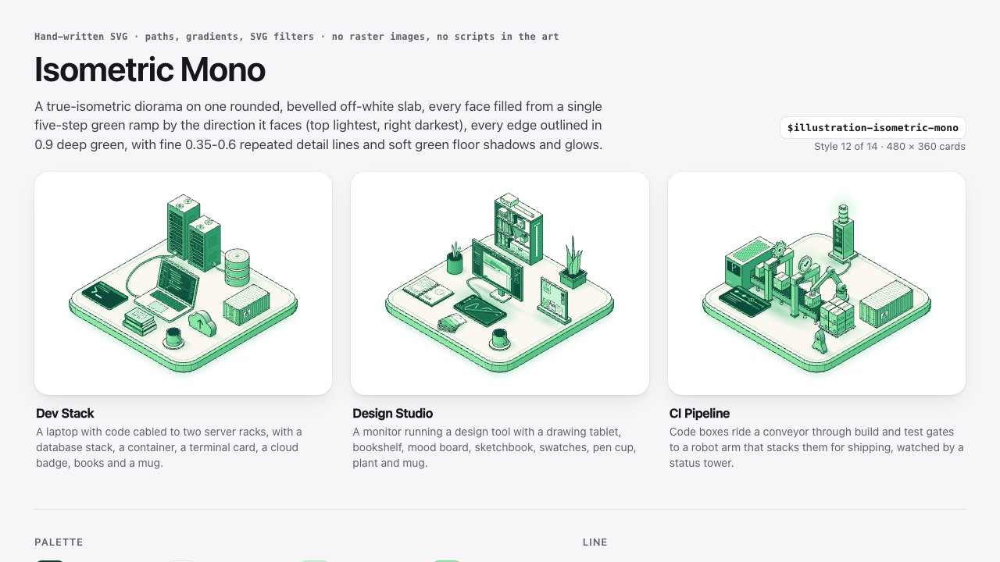

### illustration-line-interior

Draws original hand-written SVG spot scenes in the Line interior style, wide airy rooms or terraces where slim, realistic people do design and coding work. A thin uniform indigo outline (1.4 px at 480 wide) runs around mostly white fills. Sparse flat accents (teal, sage, coral, mustard, lavender, peach wood) cover under 7% of the card. Pale lavender 1 px background decor (brick clusters, pendant lamps, framed posters) sits behind, and a long floor line with end dashes runs under it all. Covers the palette, line weights, heads and hands from a parts toolkit, composition and a render-critique loop. Use when asked for line-art, thin-line or outline illustrations, indigo line art, office, desk, home-workspace, remote-work or team scenes, or interior spot illustrations for empty states, onboarding screens, 404 pages, blog headers, feature spots, landing sections or marketing cards.

[Open demo](agent-skills/illustration/illustration-line-interior/demo/index.html) · [Skill](agent-skills/illustration/illustration-line-interior/SKILL.md) · [Prompt](agent-skills/illustration/illustration-line-interior/demo/PROMPT.md) · Local demo

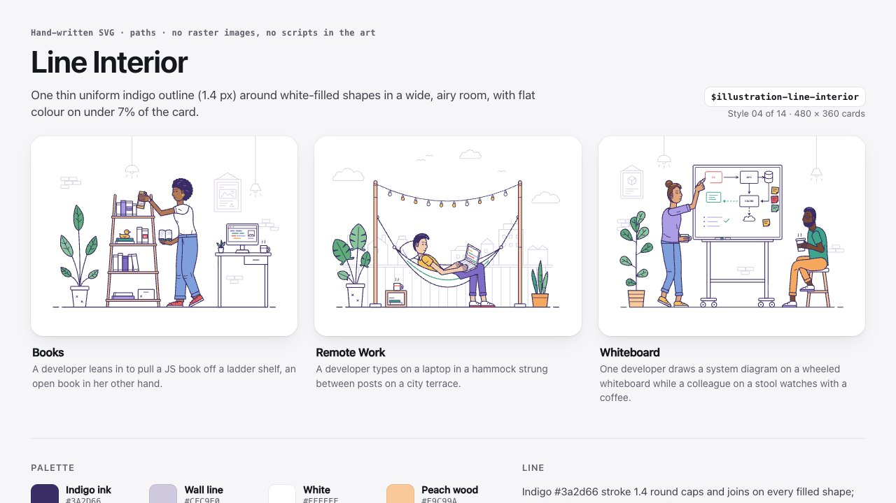

### illustration-one-line

Draws original hand-written SVG spot illustrations in the One-line style, joyful action figures doing design and coding work. One continuous uniform black line (2.3 px at 480 wide) loops and doubles back to draw the whole figure. Flat coral, periwinkle and white patches sit behind the line, wobbly and deliberately knocked 2–6 px out of register like a misprinted riso. Tops carry coral stripe lines, and there is no ground plane, only a squiggle, a curl or a few speed strokes, all on warm beige paper. Covers the palette, a route-building toolkit (tube limbs, hand and shoe loops, wobble patches, masks), poses, composition and a render-critique loop. Use when asked for one-line, single-line, continuous-line, misregistered, riso-style or playful doodle illustrations, for empty states, onboarding, 404 pages, blog headers, feature spots, launch announcements or marketing cards.

[Open demo](agent-skills/illustration/illustration-one-line/demo/index.html) · [Skill](agent-skills/illustration/illustration-one-line/SKILL.md) · [Prompt](agent-skills/illustration/illustration-one-line/demo/PROMPT.md) · Local demo

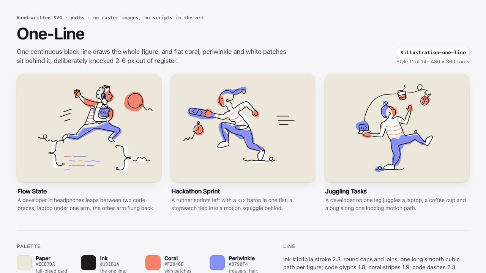

### illustration-outlined-cartoon

Draws original hand-authored SVG spot illustrations in an outlined cartoon style for design and coding subjects. Identifying traits: a warm near-black ink outline on every flat fill in three weights (2.5 / 2 / 1.5 px), tapered ink slivers for folds, brows and finger splits, big-headed characters with huge white eyes, thick brows, open smiles and pink blush, blob hair with white highlight dashes, and a small decor set of "+" sparkle crosses, outline rings, squares and coloured dots on a transparent card. Covers one character with one hero prop, gripping and holding hands, sneakers, clothing folds and UI props. Use when someone asks for an outlined, inked, comic, sticker or doodle-style cartoon, a friendly character or mascot, or a spot illustration for an empty state, onboarding, 404 or error page, success state, blog header, feature spot or marketing card.

[Open demo](agent-skills/illustration/illustration-outlined-cartoon/demo/index.html) · [Skill](agent-skills/illustration/illustration-outlined-cartoon/SKILL.md) · [Prompt](agent-skills/illustration/illustration-outlined-cartoon/demo/PROMPT.md) · Local demo

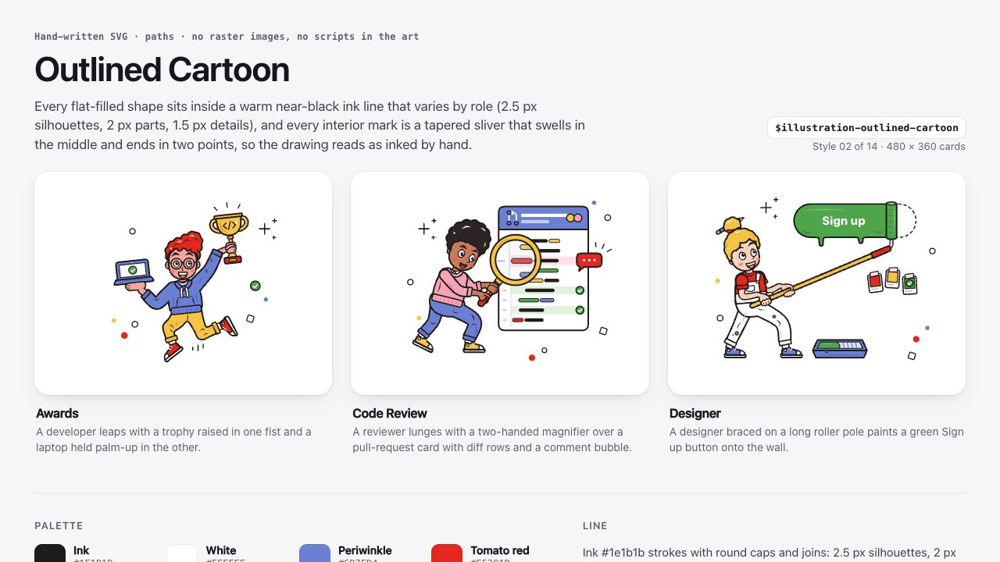

### illustration-teal-spot

Draws original spot illustrations of one hero object as SVG cards (480x360) in a teal-on-white style. Identifying traits are a single object in a fixed oblique 3/4 view showing top, front and right faces; white main faces with teal only on side faces and accents; thin dark-teal outlines on every edge; a hard, unblurred deep-teal drop shadow pushed down-right; and two to four small floating extras (coins, tilted UI cards, badges) with their own hard shadows, plus 4-point sparkles. No people. Covers design and coding concepts as objects: keyboards, databases, git graphs, inboxes, devices. Use when someone asks for a teal spot, teal icon illustration, isometric spot object, 3D line spot, empty-state art, onboarding step art, a 404 or error spot, a feature spot, a blog header object, a marketing card or a product icon scene in teal, mint or green-teal.

[Open demo](agent-skills/illustration/illustration-teal-spot/demo/index.html) · [Skill](agent-skills/illustration/illustration-teal-spot/SKILL.md) · [Prompt](agent-skills/illustration/illustration-teal-spot/demo/PROMPT.md) · Local demo

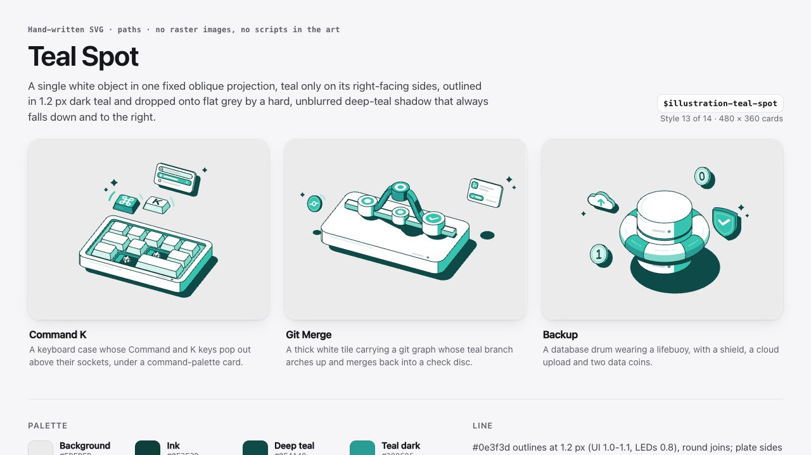

### illustration-two-colour-brush

Draws original design and coding scenes as hand-authored SVG cards (480x360) in a two-colour brush-marker style. Identifying traits: thick wobbly black marker lines with blobby ends, built as filled ribbons; one second ink, mint green, in flat blocks that slip 2-10 px off the line like a misregistered print; solid black hair, trousers and shoes with mint highlight dashes; and a crinkly squiggle camo on cream areas, all on warm cream paper. Characters are chunky, with profile heads, big noses, dot eyes, big hands and feet. It covers people coding, thinking, carrying and resting with laptops, mugs, chairs and rubber ducks. Use when someone asks for brush, marker, felt-tip, two-colour, duotone, riso-print, zine, mint-and-black or doodle illustrations, or for empty states, onboarding, 404 pages, blog headers, feature spots or marketing cards with a bold hand-made look.

[Open demo](agent-skills/illustration/illustration-two-colour-brush/demo/index.html) · [Skill](agent-skills/illustration/illustration-two-colour-brush/SKILL.md) · [Prompt](agent-skills/illustration/illustration-two-colour-brush/demo/PROMPT.md) · Local demo

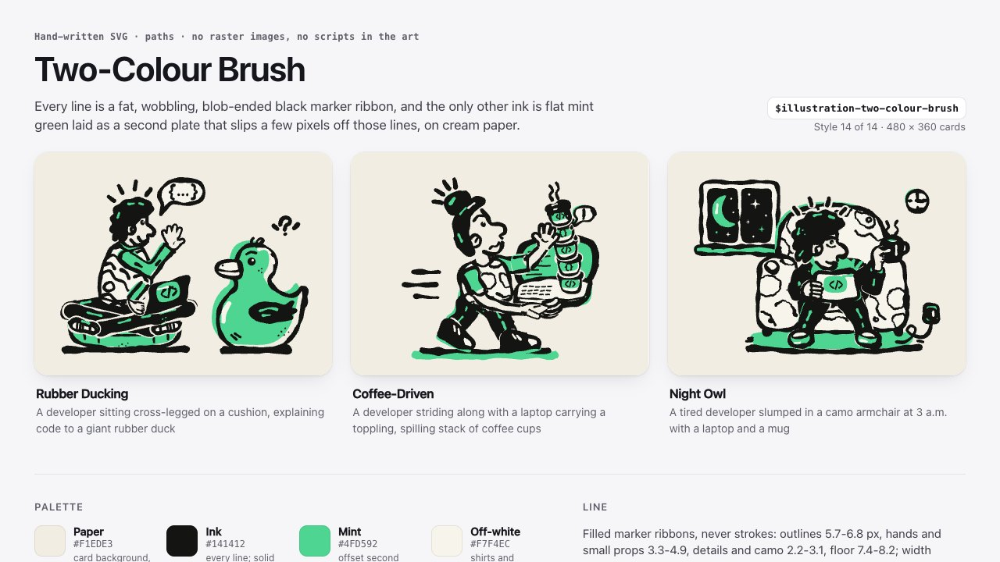

### illustration-vintage-emblem

Draws original hand-authored SVG badge illustrations in a vintage emblem style for design and coding subjects. Identifying traits: a seven-colour screen-print palette (green-black ink, cream, terracotta, sand, tan, pale, a touch of teal) with no gradients; one chunky hero object in thick 3.6 px ink outlines, shaded with woodcut gouges and lit with pale streaks; a terracotta sun disc behind it, cut free by a 7.5 px cream keyline; a hard horizontal edge slicing the scene into a dark splash band with cream droplets punched out; a heavy condensed wordmark over a letterspaced serif tagline. Covers lockups, hero objects, gulls, splash bands and lettering. Use when someone asks for a vintage emblem, retro badge, crest, logo-style, screen-print, poster, sticker, patch or merch-style illustration, or a badge card for a team, event, release, empty state, 404 page, blog header or marketing card.

[Open demo](agent-skills/illustration/illustration-vintage-emblem/demo/index.html) · [Skill](agent-skills/illustration/illustration-vintage-emblem/SKILL.md) · [Prompt](agent-skills/illustration/illustration-vintage-emblem/demo/PROMPT.md) · Local demo

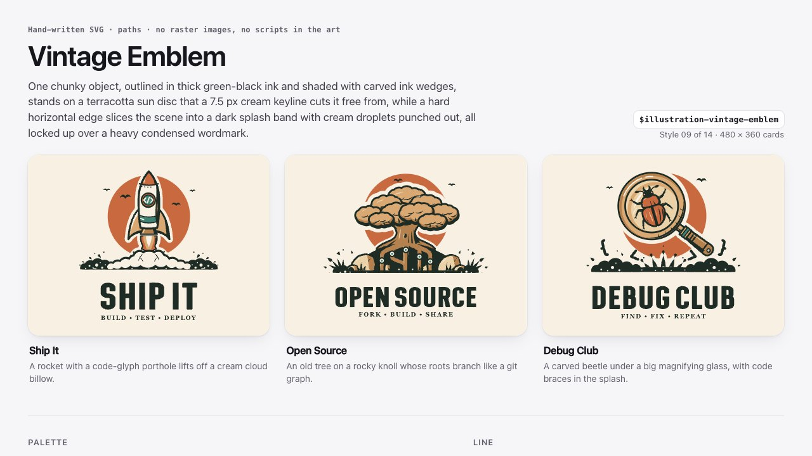

## media (6)

### aura-asset-images

Use when you need high-quality stock-style images from Aura Assets (aura.build/assets) similar to Unsplash for design mockups and marketing: backgrounds, abstract wallpapers, architecture, portraits, and headshots. Includes a workflow for searching by tag on aura.build/assets and returns 5 real image URLs per category plus practical guidance for using different resolutions and aspect ratios.

[Open demo](agent-skills/media/aura-asset-images/demo/index.html) · [Skill](agent-skills/media/aura-asset-images/SKILL.md) · [Prompt](agent-skills/media/aura-asset-images/demo/PROMPT.md) · Neuform #1 · 2,154 views

### create-ai-avatar

Make an AI avatar of yourself that looks and sounds like you. A HeyGen digital twin trained on a couple of minutes of your own footage says lines you never recorded, in your own ElevenLabs voice, lip-synced from the audio, on the engine whose mouth moves most like yours. Covers picking and joining takes, training, consent, making the voice, rendering the same line on Avatar 6 (HeyGen's newest, through Fil), V, IV and III, and judging them mouth to mouth against your real footage before anything else is made. Use when someone wants a digital twin, an AI avatar or talking head of themselves or a consenting person, a HeyGen avatar from their YouTube videos or recordings, their avatar to speak in their own cloned voice, a lip-synced talking video from a photo and audio, or says their avatar looks wrong, over-acts or its mouth isn't theirs.

[Open demo](agent-skills/media/create-ai-avatar/demo/index.html) · [Skill](agent-skills/media/create-ai-avatar/SKILL.md) · [Prompt](agent-skills/media/create-ai-avatar/demo/PROMPT.md) · Local demo

### digital-twin

Build a digital twin of yourself, meaning photoreal stills of you in your own real room, talking video clips of you, and lines in your own cloned voice, that people who know you accept as you. It's a proven workflow (160+ numbered stills over two dozen rounds, 20+ talking drafts and a voice taken from 8.7 to 9.2/10 on one creator's twin, Nov 2026). It covers consent, picking references from your own recordings, writing an identity prompt, the 4-part prompt stack on Seedream 5 Pro, your-real-room-only with the camera as the only variable, 3 images at a time, cinematic looks taken from reference videos as words, measuring face proportions, the audit and paste-back fix, an instant voice clone with an audio tag, a speaker-similarity scorer, Seedance 2.5 draft talking clips, and the traps (voice verification lockouts, iMacs, grey hair, wide mouths, other people's faces bleeding in). Use it whenever someone wants AI images, video or voice of THEMSELVES, even if they only say "my digital twin", "AI headshots of me", "a video of me talking", "clone my voice", "make me a presenter clip", "an AI avatar of me", "me at my desk", "a talking-head intro without filming" or "creator or founder content with my face". Only for your own face and voice, or someone who gave documented consent.

[Open demo](agent-skills/media/digital-twin/demo/index.html) · [Skill](agent-skills/media/digital-twin/SKILL.md) · [Prompt](agent-skills/media/digital-twin/demo/PROMPT.md) · Local demo

### html-explainer-video

Turn a product, a feature or an idea into a finished one-minute explainer video in any look: a script (hook, benefit, quick tutorial, try it), a voice whose words are the clock, HTML scenes drawn from that one clock and rendered frame by frame at 2×, and an edit in Fil's video editor over MCP with captions, music, sound effects and chapters. The look is an input, read from the person's site or a named style, so the same film can wear any type, colour, corners and motion. The shape is an input (4:3, 16:9, 1:1, 9:16). No camera by default: a voice-led film whose scenes fill the frame; ask for a camera and it adds record slots, layouts by keyframes and a teleprompter. Use when someone wants an explainer, a feature video, a product walkthrough, an onboarding video, a how-it-works video or a launch video, wants one in their own brand, or wants it without filming anything.

[Open demo](agent-skills/media/html-explainer-video/demo/index.html) · [Skill](agent-skills/media/html-explainer-video/SKILL.md) · [Prompt](agent-skills/media/html-explainer-video/demo/PROMPT.md) · Local demo

### html-reel

Turn a tweet, a video, a YouTube video or a landing page into a 9:16 reel (Instagram Reels, TikTok, Shorts) that says what the source says and looks like it, with every cut on a word. Read the source (its words, its media, its measured fonts and colours), pick a structure (a promo, a showcase, "found this", an explainer, before and after), write the script in the creator's voice from the source's own facts, make the voice with timestamps (their cloned ElevenLabs voice), then build the picture from HTML scenes drawn from one clock (window.__frame(t)) in the source's look, opening on its cover (the hook's best moment as the first frame), its demo video framed and cut to words, and assemble it in Fil's video editor over MCP. The creator is in it from the first draft as a placeholder in the camera layouts (a backlit studio silhouette) (full frame, a bubble, half the frame), swapped for their on-camera clips (their approved HeyGen Avatar 6 twin speaking the final voice; phone takes for a creator who records, with everything retimed to their own words by word anchors, t = W(τ)); a reel can also be faceless. Use when someone wants a reel, a short or a vertical video from a post, a thread, a launch, a landing page, a demo video or a YouTube video, "a reel like this one", or a talking-head promo cut to their own delivery.

[Open demo](agent-skills/media/html-reel/demo/index.html) · [Skill](agent-skills/media/html-reel/SKILL.md) · [Prompt](agent-skills/media/html-reel/demo/PROMPT.md) · Local demo

### unsplash-asset-images

Use when you need to pick high-quality Unsplash images for product/design assets (avatars, headshots, portraits, large website backgrounds, and abstract wallpapers) and output real Unsplash URLs plus practical instructions for producing the right resolutions and aspect ratios (1:1, 4:5, 3:4, 16:9, 9:16).

[Open demo](agent-skills/media/unsplash-asset-images/demo/index.html) · [Skill](agent-skills/media/unsplash-asset-images/SKILL.md) · [Prompt](agent-skills/media/unsplash-asset-images/demo/PROMPT.md) · Local demo

## ui (5)

### design-first-ui-prompting

Use when you need design-first, spec-driven, skimmable prompts for UI generation. Covers prompt structure, constraints, variations, typography/spacing rules, and iteration workflow for consistent UI outputs.

[Open demo](agent-skills/ui/design-first-ui-prompting/demo/index.html) · [Skill](agent-skills/ui/design-first-ui-prompting/SKILL.md) · [Prompt](agent-skills/ui/design-first-ui-prompting/demo/PROMPT.md) · Local demo

### moss-glass-controls

Build Sylva-style dark glass action pills and woodland cards with an inset rim, pale icon well and a gradient that travels around the edge on hover.

[Open demo](agent-skills/ui/moss-glass-controls/demo/index.html) · [Skill](agent-skills/ui/moss-glass-controls/SKILL.md) · [Prompt](agent-skills/ui/moss-glass-controls/demo/PROMPT.md)

### refract-liquid-glass

Trace a rounded glass lip over a live backdrop and let a dragged panel flex at the grip.

[Open demo](agent-skills/ui/refract-liquid-glass/demo/index.html) · [Skill](agent-skills/ui/refract-liquid-glass/SKILL.md) · [Prompt](agent-skills/ui/refract-liquid-glass/demo/PROMPT.md)

### segmented-field-menu

Create an inset upper-right navigation dock with compact icon-and-label segments, a pale selected segment and a matching footer dock for an editorial landing page.

[Open demo](agent-skills/ui/segmented-field-menu/demo/index.html) · [Skill](agent-skills/ui/segmented-field-menu/SKILL.md) · [Prompt](agent-skills/ui/segmented-field-menu/demo/PROMPT.md)

### shade-glass-button-press

Gather the glass under the fingertip and send a refractive crest to the opposite rim.

[Open demo](agent-skills/ui/shade-glass-button-press/demo/index.html) · [Skill](agent-skills/ui/shade-glass-button-press/SKILL.md) · [Prompt](agent-skills/ui/shade-glass-button-press/demo/PROMPT.md)

## web-design (93)

### add-mouse-driven-orbit

Add restrained mouse-driven orbit and parallax depth to a Three.js hero by damping one pointer target and splitting it across camera translation, look-at, and small object rotations. Use for passive cinematic 3D heroes, pointer-responsive scenes, organic model parallax, and interactive depth where OrbitControls would feel like a product viewer.

[Open demo](agent-skills/web-design/add-mouse-driven-orbit/demo/index.html) · [Skill](agent-skills/web-design/add-mouse-driven-orbit/SKILL.md) · [Prompt](agent-skills/web-design/add-mouse-driven-orbit/demo/PROMPT.md) · Local demo

### agency-grid-layout-minimal

Create a minimal agency design system with a disciplined editorial grid, oversized typography, quiet uppercase utility labels, restrained image blocks, and subtle structural detail.

[Open demo](agent-skills/web-design/agency-grid-layout-minimal/demo/index.html) · [Skill](agent-skills/web-design/agency-grid-layout-minimal/SKILL.md) · [Prompt](agent-skills/web-design/agency-grid-layout-minimal/demo/PROMPT.md) · Neuform #1 · 731 views

### ambient-section-particles

Add a restrained particle atmosphere inside one section with configurable shapes, density, gravity, wind, sway, rotation, recycling or settling, pointer disturbance, visibility pausing, responsive limits, and reduced-motion fallbacks. Use for petals, leaves, snow, sparks, confetti, dots, paper, icons, or brand fragments that support a section's mood without obscuring content.

[Open demo](agent-skills/web-design/ambient-section-particles/demo/index.html) · [Skill](agent-skills/web-design/ambient-section-particles/SKILL.md) · [Prompt](agent-skills/web-design/ambient-section-particles/demo/PROMPT.md) · Local demo

### animation-on-scroll

Create an on-scroll animation trigger using IntersectionObserver with Tailwind-friendly animation classes and keyframes. Use when asked for scroll-reveal, animate-on-scroll, or sequencing element animations when they enter the viewport.

[Open demo](agent-skills/web-design/animation-on-scroll/demo/index.html) · [Skill](agent-skills/web-design/animation-on-scroll/SKILL.md) · [Prompt](agent-skills/web-design/animation-on-scroll/demo/PROMPT.md) · Local demo

### animation-systems

Use when designing or implementing product-grade web motion like Stripe, Linear, Apple, and Vercel. Covers motion principles, easing/duration defaults, choreography patterns, scroll/hover interactions, performance, accessibility (reduced motion), and implementation guidance.

[Open demo](agent-skills/web-design/animation-systems/demo/index.html) · [Skill](agent-skills/web-design/animation-systems/SKILL.md) · [Prompt](agent-skills/web-design/animation-systems/demo/PROMPT.md) · Local demo

### atmosphere-background

Create a dark atmospheric background with drifting vertical light folds, screen-blended glow, and a concentrated luminous corner or lower-edge bloom.

[Open demo](agent-skills/web-design/atmosphere-background/demo/index.html) · [Skill](agent-skills/web-design/atmosphere-background/SKILL.md) · [Prompt](agent-skills/web-design/atmosphere-background/demo/PROMPT.md) · Local demo

### background-grid-webgl

Create a perspective WebGL background grid with fading lines, subtle particle haze, slow forward drift, and gentle camera parallax.

[Open demo](agent-skills/web-design/background-grid-webgl/demo/index.html) · [Skill](agent-skills/web-design/background-grid-webgl/SKILL.md) · [Prompt](agent-skills/web-design/background-grid-webgl/demo/PROMPT.md) · Neuform #1 · 351 views

### beautiful-shadows

Apply exact Tailwind arbitrary shadow utilities for polished, layered neutral elevation. Use when compact cards, controls, panels, popovers, hero media, feature callouts, or modal-like containers need refined shadows without default Tailwind shadow scales or colored tinting.

[Open demo](agent-skills/web-design/beautiful-shadows/demo/index.html) · [Skill](agent-skills/web-design/beautiful-shadows/SKILL.md) · [Prompt](agent-skills/web-design/beautiful-shadows/demo/PROMPT.md) · Neuform #1 · 1,953 views

### blue-cloudy-clean-modern

Create a clean modern design system with a luminous blue sky atmosphere, soft drifting cloud light, minimal white framing, and serene premium typography.

[Open demo](agent-skills/web-design/blue-cloudy-clean-modern/demo/index.html) · [Skill](agent-skills/web-design/blue-cloudy-clean-modern/SKILL.md) · [Prompt](agent-skills/web-design/blue-cloudy-clean-modern/demo/PROMPT.md) · Neuform #1 · 351 views

### blue-laser-clean-glass-layout

Create a clean dark glass layout system with a thin blue laser atmosphere, frosted premium shells, and polished dashboard structure.

[Open demo](agent-skills/web-design/blue-laser-clean-glass-layout/demo/index.html) · [Skill](agent-skills/web-design/blue-laser-clean-glass-layout/SKILL.md) · [Prompt](agent-skills/web-design/blue-laser-clean-glass-layout/demo/PROMPT.md) · Local demo

### book-serif-index

Create an archival book-reader design system with serif-led pages, mono index navigation, aged paper surfaces, margin notes, and a premium catalog frame.

[Open demo](agent-skills/web-design/book-serif-index/demo/index.html) · [Skill](agent-skills/web-design/book-serif-index/SKILL.md) · [Prompt](agent-skills/web-design/book-serif-index/demo/PROMPT.md) · Neuform #1 · 80 views

### bright-green-tech-system-webgl

Create a bright-green technical design system with structured split layouts, hard-framed dark surfaces, mono utility labels, and a prominent WebGL visualization zone.

[Open demo](agent-skills/web-design/bright-green-tech-system-webgl/demo/index.html) · [Skill](agent-skills/web-design/bright-green-tech-system-webgl/SKILL.md) · [Prompt](agent-skills/web-design/bright-green-tech-system-webgl/demo/PROMPT.md) · Local demo

### build-interactive-particle-trail

Build a cursor or touch particle interaction that emits by distance along the traveled segment into a recycled GPU point pool, with optional keyboard-triggered bursts. Use for interactive particle trails, pollen lifted from a surface, dust disturbed by a pointer, hover particle bursts, and discrete motes whose spacing must stay consistent at different gesture speeds.

[Open demo](agent-skills/web-design/build-interactive-particle-trail/demo/index.html) · [Skill](agent-skills/web-design/build-interactive-particle-trail/SKILL.md) · [Prompt](agent-skills/web-design/build-interactive-particle-trail/demo/PROMPT.md) · Local demo

### build-threejs-scroll-worlds

Build rich, scroll-controlled real-time Three.js experiences as one persistent 3D world whose camera, lighting, atmosphere, materials, objects, DOM story, and interactions evolve across authored chapters. Use for 3D scrollytelling, scroll-driven WebGL worlds, camera journeys, interactive portfolios, product stories, exhibitions, explainers, game or film microsites, spatial narratives, and multi-scene websites where native scroll should travel through one continuous place. Not limited to landing pages.

[Open demo](agent-skills/web-design/build-threejs-scroll-worlds/demo/index.html) · [Skill](agent-skills/web-design/build-threejs-scroll-worlds/SKILL.md) · [Prompt](agent-skills/web-design/build-threejs-scroll-worlds/demo/PROMPT.md) · Local demo

### build-wireframe-scan-reveal

Reveal Three.js geometry with an expanding world-space scan whose wire cage leads the solid surface, then burns away. Use for wireframe scanning, radial mesh reveals, survey pulses, holographic assembly, topology intros, and 3D model entrances where a plain opacity wipe does not explain the form.

[Open demo](agent-skills/web-design/build-wireframe-scan-reveal/demo/index.html) · [Skill](agent-skills/web-design/build-wireframe-scan-reveal/SKILL.md) · [Prompt](agent-skills/web-design/build-wireframe-scan-reveal/demo/PROMPT.md) · Local demo

### cinematic-gsap-lenis-motion-system

Create premium cinematic web motion systems with GSAP, ScrollTrigger, and Lenis. Use for luxury editorial websites, creative studio portfolios, Awwwards-style interactions, smooth scroll reveals, staggered text, parallax, pinned sections, magnetic hover states, custom cursors, and mouse-reactive layered movement.

[Open demo](agent-skills/web-design/cinematic-gsap-lenis-motion-system/demo/index.html) · [Skill](agent-skills/web-design/cinematic-gsap-lenis-motion-system/SKILL.md) · [Prompt](agent-skills/web-design/cinematic-gsap-lenis-motion-system/demo/PROMPT.md) · Local demo

### cinematic-scroll-storytelling

Create cinematic scroll-driven landing pages with Lenis smooth scrolling, GSAP ScrollTrigger, scroll-linked progression, staggered text reveals, sticky card stacks, parallax backgrounds, scroll-scrubbed transitions, footer reveals, and immersive preloaders. Use when analyzing or building premium editorial scroll experiences, sticky project stacks, kinetic typography, or section-by-section storytelling.

[Open demo](agent-skills/web-design/cinematic-scroll-storytelling/demo/index.html) · [Skill](agent-skills/web-design/cinematic-scroll-storytelling/SKILL.md) · [Prompt](agent-skills/web-design/cinematic-scroll-storytelling/demo/PROMPT.md) · Local demo

### clean-minimal-beige-light-mode

Create a clean minimal beige light-mode design system with warm neutral shells, quiet process grids, restrained accent color, and elegant low-contrast structure.

[Open demo](agent-skills/web-design/clean-minimal-beige-light-mode/demo/index.html) · [Skill](agent-skills/web-design/clean-minimal-beige-light-mode/SKILL.md) · [Prompt](agent-skills/web-design/clean-minimal-beige-light-mode/demo/PROMPT.md) · Neuform #1 · 744 views

### cobejs

Use when adding a lightweight interactive globe with cobe (canvas setup, markers, interaction, performance, integration with React/Next.js).

[Open demo](agent-skills/web-design/cobejs/demo/index.html) · [Skill](agent-skills/web-design/cobejs/SKILL.md) · [Prompt](agent-skills/web-design/cobejs/demo/PROMPT.md) · Local demo

### company-logos

Use Iconify Simple Icons logos (64x64) instead of text logos.

[Open demo](agent-skills/web-design/company-logos/demo/index.html) · [Skill](agent-skills/web-design/company-logos/SKILL.md) · [Prompt](agent-skills/web-design/company-logos/demo/PROMPT.md) · Neuform #1 · 435 views

### compose-a-woodland-landing-page

Compose a Sylva-style botanical landing page as a six-chapter field guide, alternating light editorial spreads, dark participation cards and live woodland views.

[Open demo](agent-skills/web-design/compose-a-woodland-landing-page/demo/index.html) · [Skill](agent-skills/web-design/compose-a-woodland-landing-page/SKILL.md) · [Prompt](agent-skills/web-design/compose-a-woodland-landing-page/demo/PROMPT.md)

### container-lines

Add vertical container-size guide lines with mini corner squares for precise, structured web layouts. Use when asked for container lines, measured layout guides, vertical boundary lines, editorial grid markers, or small corner-square frame details.

[Open demo](agent-skills/web-design/container-lines/demo/index.html) · [Skill](agent-skills/web-design/container-lines/SKILL.md) · [Prompt](agent-skills/web-design/container-lines/demo/PROMPT.md) · Neuform #1 · 2,154 views

### corner-diagonals

Apply diagonal-cut corners and chamfered edges to buttons, cards, panels, and container shells. Use when a design needs precise geometric framing, sci-fi UI surfaces, clipped-corner controls, or engineered sharp containers instead of rounded pills or plain rectangles.

[Open demo](agent-skills/web-design/corner-diagonals/demo/index.html) · [Skill](agent-skills/web-design/corner-diagonals/SKILL.md) · [Prompt](agent-skills/web-design/corner-diagonals/demo/PROMPT.md) · Neuform #1 · 1,953 views

### corner-lasers

Create a corner-anchored laser composition with thin beams, a bright emitter node, bloom, and atmospheric glow or fog.

[Open demo](agent-skills/web-design/corner-lasers/demo/index.html) · [Skill](agent-skills/web-design/corner-lasers/SKILL.md) · [Prompt](agent-skills/web-design/corner-lasers/demo/PROMPT.md) · Neuform #1 · 278 views

### css-alpha-masking

Apply CSS alpha masking with linear-gradient for horizontal or vertical edge fades (mask-image and -webkit-mask-image). Use when asked for alpha masks, fade edges, or CSS mask gradients.

[Open demo](agent-skills/web-design/css-alpha-masking/demo/index.html) · [Skill](agent-skills/web-design/css-alpha-masking/SKILL.md) · [Prompt](agent-skills/web-design/css-alpha-masking/demo/PROMPT.md) · Local demo

### css-border-gradient

Apply subtle gradient-border treatments for premium web surfaces. Use when cards, pricing panels, nav bars, modals, buttons, or hero surfaces need a refined edge highlight without a loud glow.

[Open demo](agent-skills/web-design/css-border-gradient/demo/index.html) · [Skill](agent-skills/web-design/css-border-gradient/SKILL.md) · [Prompt](agent-skills/web-design/css-border-gradient/demo/PROMPT.md) · Neuform #1 · 2,154 views

### dark-blue-contrasting-clean

Create a dark-blue clean design system with strong contrast, cobalt gradient feature blocks, crisp framed structure, and restrained premium glow.

[Open demo](agent-skills/web-design/dark-blue-contrasting-clean/demo/index.html) · [Skill](agent-skills/web-design/dark-blue-contrasting-clean/SKILL.md) · [Prompt](agent-skills/web-design/dark-blue-contrasting-clean/demo/PROMPT.md) · Local demo

### dark-glass-clean-layout

Create a dark glass layout system with frosted premium shells, clean multi-column workspace structure, floating data cards, and restrained atmospheric depth.

[Open demo](agent-skills/web-design/dark-glass-clean-layout/demo/index.html) · [Skill](agent-skills/web-design/dark-glass-clean-layout/SKILL.md) · [Prompt](agent-skills/web-design/dark-glass-clean-layout/demo/PROMPT.md) · Local demo

### dither-ascii-ink-hover

Reveal warm dither dots and ASCII marks beneath the pointer on an illustration using intersecting CSS masks. Use for a printed, holographic inspection effect with a one-pass scan.

[Open demo](agent-skills/web-design/dither-ascii-ink-hover/demo/index.html) · [Skill](agent-skills/web-design/dither-ascii-ink-hover/SKILL.md) · [Prompt](agent-skills/web-design/dither-ascii-ink-hover/demo/PROMPT.md)

### dither-background

Create a dark monochrome procedural background with enlarged square pixels and visible Bayer-style ordered dithering. Use when a page needs an atmospheric near-black dither field, broad organic waves or cloud masses, and restrained gray-white highlights behind framed UI, hero content, or data overlays.

[Open demo](agent-skills/web-design/dither-background/demo/index.html) · [Skill](agent-skills/web-design/dither-background/SKILL.md) · [Prompt](agent-skills/web-design/dither-background/demo/PROMPT.md) · Neuform #1 · 1,043 views

### dither-laser-dark-mode

Create a dark premium design system that combines near-black surfaces, subtle ordered-dither texture, and a thin accent-colored laser atmosphere.

[Open demo](agent-skills/web-design/dither-laser-dark-mode/demo/index.html) · [Skill](agent-skills/web-design/dither-laser-dark-mode/SKILL.md) · [Prompt](agent-skills/web-design/dither-laser-dark-mode/demo/PROMPT.md) · Neuform #1 · 322 views

### documentary-brutalist-agency

Create or redesign creative agency, production studio, architecture, culture, and portfolio websites with billboard typography, hard black-and-white chapters, exposed grids, documentary imagery, irregular collages, restrained parallax, brutalist navigation, and accessible FAQ controls.

[Open demo](agent-skills/web-design/documentary-brutalist-agency/demo/index.html) · [Skill](agent-skills/web-design/documentary-brutalist-agency/SKILL.md) · [Prompt](agent-skills/web-design/documentary-brutalist-agency/demo/PROMPT.md) · Local demo

### editorial-portfolio-chapters

Create or redesign creative-studio, agency, photographer, artist, and portfolio websites where project work leads the story. Use for dark editorial shells, full-bleed campaign media, color-coded case-study chapters, oversized service typography, restrained project reveals, and a decisive contact finale.

[Open demo](agent-skills/web-design/editorial-portfolio-chapters/demo/index.html) · [Skill](agent-skills/web-design/editorial-portfolio-chapters/SKILL.md) · [Prompt](agent-skills/web-design/editorial-portfolio-chapters/demo/PROMPT.md) · Local demo

### editorial-service-booking

Create or redesign appointment-based service websites for salons, barbers, spas, wellness studios, clinics, and hospitality brands. Use for warm editorial layouts, serif-led identity, documentary portrait crops, calm treatment selectors, location-aware booking, and operational states that remain elegant and trustworthy.

[Open demo](agent-skills/web-design/editorial-service-booking/demo/index.html) · [Skill](agent-skills/web-design/editorial-service-booking/SKILL.md) · [Prompt](agent-skills/web-design/editorial-service-booking/demo/PROMPT.md) · Local demo

### editorial-tech

Blend editorial magazine composition with precision product-tech detailing using asymmetrical grids, cinematic media bands, mono utility labels, and restrained accent color.

[Open demo](agent-skills/web-design/editorial-tech/demo/index.html) · [Skill](agent-skills/web-design/editorial-tech/SKILL.md) · [Prompt](agent-skills/web-design/editorial-tech/demo/PROMPT.md) · Neuform #1 · 607 views

### falling-leaves

Build falling leaves that read as leaves, with each one tumbling on its own axis so it presents a face, thins to an edge, and opens out again, and with its sideways slip driven by that same tumble. Covers the 2-D canvas build and the instanced-3-D variant, where leaves are recycled from, density-versus-count maths, depth layering, colour under a tone-mapped composite, reduced motion, and visibility pausing. Use for autumn maple, sakura petals, blossom, ash, snowfall shapes, or any drifting foliage where a generic particle field reads as confetti.

[Open demo](agent-skills/web-design/falling-leaves/demo/index.html) · [Skill](agent-skills/web-design/falling-leaves/SKILL.md) · [Prompt](agent-skills/web-design/falling-leaves/demo/PROMPT.md) · Local demo

### framed-grid-layout

Create minimal framed grid layouts with thin visible boundary lines, L-shaped corner brackets, subtle diagonal line texture, and strict section alignment. Use when asked for clean, neutral, precise, structured, editorial, technical, or guide-border web layouts.

[Open demo](agent-skills/web-design/framed-grid-layout/demo/index.html) · [Skill](agent-skills/web-design/framed-grid-layout/SKILL.md) · [Prompt](agent-skills/web-design/framed-grid-layout/demo/PROMPT.md) · Neuform #1 · 1,043 views

### framed-tech-dark-border-gradient

Create a framed dark technical design system with border-gradient shells, asymmetrical grid panels, mono utility labeling, and restrained monochrome atmosphere.

[Open demo](agent-skills/web-design/framed-tech-dark-border-gradient/demo/index.html) · [Skill](agent-skills/web-design/framed-tech-dark-border-gradient/SKILL.md) · [Prompt](agent-skills/web-design/framed-tech-dark-border-gradient/demo/PROMPT.md) · Local demo

### funky-purple-container-tech

Create a dark container-led technical design system with fuchsia-purple accents, layered rounded shells, crisp frame lines, and playful futuristic focal objects.

[Open demo](agent-skills/web-design/funky-purple-container-tech/demo/index.html) · [Skill](agent-skills/web-design/funky-purple-container-tech/SKILL.md) · [Prompt](agent-skills/web-design/funky-purple-container-tech/demo/PROMPT.md) · Local demo

### generate-ledger-logo-register

Generate a family of original fictional wordmarks on a Seedream contact sheet, extract transparent assets, and present them as a partner or studio logo register.

[Open demo](agent-skills/web-design/generate-ledger-logo-register/demo/index.html) · [Skill](agent-skills/web-design/generate-ledger-logo-register/SKILL.md) · [Prompt](agent-skills/web-design/generate-ledger-logo-register/demo/PROMPT.md)

### glass-dark-mode-clock

Create a dark glass design system with frosted shells, soft beam grids, circular clock-like calibration dials, and precise sci-fi instrument framing.

[Open demo](agent-skills/web-design/glass-dark-mode-clock/demo/index.html) · [Skill](agent-skills/web-design/glass-dark-mode-clock/SKILL.md) · [Prompt](agent-skills/web-design/glass-dark-mode-clock/demo/PROMPT.md) · Neuform #1 · 1,043 views

### glass-dark-ui

Build dark-mode glassmorphism interfaces with readable contrast, frosted surfaces, and gradient borders using a pseudo-element mask. Use when asked for glass cards, frosted dark hero sections, blur panels, or dark UI systems with gradient/glow borders.

[Open demo](agent-skills/web-design/glass-dark-ui/demo/index.html) · [Skill](agent-skills/web-design/glass-dark-ui/SKILL.md) · [Prompt](agent-skills/web-design/glass-dark-ui/demo/PROMPT.md) · Local demo

### globe-gl

Use when implementing globe.gl (Globe.GL) for 3D globe data visualization with WebGL/ThreeJS, including setup, data layers (points, arcs, polygons, labels), and integration patterns in plain HTML or React.

[Open demo](agent-skills/web-design/globe-gl/demo/index.html) · [Skill](agent-skills/web-design/globe-gl/SKILL.md) · [Prompt](agent-skills/web-design/globe-gl/demo/PROMPT.md) · Local demo

### globe-particles

Create a globe-like 3D particle visualization with a dense luminous spherical core and thinner orbital ring or flattened disc. Use when a design needs a premium planetary, orbital, synthesized data-globe effect rendered with real WebGL/Three.js particles, not generic starfields or full page layout changes.

[Open demo](agent-skills/web-design/globe-particles/demo/index.html) · [Skill](agent-skills/web-design/globe-particles/SKILL.md) · [Prompt](agent-skills/web-design/globe-particles/demo/PROMPT.md) · Neuform #1 · 607 views

### gooey-blob-system

Create a gooey blob system using SVG filters where multiple shapes merge into a single fluid form. Use overlapping circles combined with a Gaussian blur and color matrix filter to produce a continuous, organic mass. The forms should visually fuse and separate based on proximity. Focus on filter-driven merging (blur + threshold effect), soft organic boundaries with no hard edges, multiple independent shapes behaving as one system, and smooth continuous motion that feels fluid and cohesive.

[Open demo](agent-skills/web-design/gooey-blob-system/demo/index.html) · [Skill](agent-skills/web-design/gooey-blob-system/SKILL.md) · [Prompt](agent-skills/web-design/gooey-blob-system/demo/PROMPT.md) · Neuform #1 · 170 views

### gradient-border-flashlight

Carry one soft pointer light across surfaces and adjacent gradient borders.

[Open demo](agent-skills/web-design/gradient-border-flashlight/demo/index.html) · [Skill](agent-skills/web-design/gradient-border-flashlight/SKILL.md) · [Prompt](agent-skills/web-design/gradient-border-flashlight/demo/PROMPT.md)

### gsap-scrolltrigger-storytelling

Build cinematic sticky product storytelling with GSAP ScrollTrigger, progressive UI reveals, scroll-synced animation, smooth interpolation, and immersive section transitions.

[Open demo](agent-skills/web-design/gsap-scrolltrigger-storytelling/demo/index.html) · [Skill](agent-skills/web-design/gsap-scrolltrigger-storytelling/SKILL.md) · [Prompt](agent-skills/web-design/gsap-scrolltrigger-storytelling/demo/PROMPT.md) · Neuform #1 · 78 views

### gsap

Use when you need to add or debug professional web animations with GSAP (timelines, ScrollTrigger, stagger, transforms) in HTML/CSS/JS/React. Includes patterns for smooth motion, performance, and common pitfalls.

[Open demo](agent-skills/web-design/gsap/demo/index.html) · [Skill](agent-skills/web-design/gsap/SKILL.md) · [Prompt](agent-skills/web-design/gsap/demo/PROMPT.md) · Neuform #1 · 857 views

### high-contrast-skeuomorphic-clean

Create a high-contrast clean skeuomorphic design system with molded dark surfaces, crisp light separation, tactile inset depth, and restrained signal accents.

[Open demo](agent-skills/web-design/high-contrast-skeuomorphic-clean/demo/index.html) · [Skill](agent-skills/web-design/high-contrast-skeuomorphic-clean/SKILL.md) · [Prompt](agent-skills/web-design/high-contrast-skeuomorphic-clean/demo/PROMPT.md) · Neuform #1 · 851 views

### html-demo

Show an app working on a web page by drawing it live in HTML instead of recording it. A Mac-style window plays the app step by step, and every frame is a pure function of one clock, View(t), drawn on a fixed 1200 × 750 stage that one CSS scale fits to any width. The pointer is scripted, labels and pictures come from the real app, a steps bar sits under the window, it plays only while on screen, and reduced motion gets designed end frames. Use when someone wants a product demo, an animated app window or hero, a feature walkthrough, "the UI animated and simulated in HTML", "like a screen recording but HTML", an interactive product tour on a landing or download page, or wants to replace screen recordings, GIFs or MP4s of their UI with crisp live HTML. Also use to build many such windows at once with helper agents, or to scrub, freeze and screenshot them.

[Open demo](agent-skills/web-design/html-demo/demo/index.html) · [Skill](agent-skills/web-design/html-demo/SKILL.md) · [Prompt](agent-skills/web-design/html-demo/demo/PROMPT.md) · Local demo

### image-first-grid-layout

Create an image-led grid design system with full-bleed photography, structural guide lines, anchored content blocks, and restrained technical overlays.

[Open demo](agent-skills/web-design/image-first-grid-layout/demo/index.html) · [Skill](agent-skills/web-design/image-first-grid-layout/SKILL.md) · [Prompt](agent-skills/web-design/image-first-grid-layout/demo/PROMPT.md) · Neuform #1 · 2,154 views

### landing-page

Use when designing or rewriting a high-converting landing page (single-offer page) for SaaS/apps/services. Covers structure, layout patterns, conversion strategies, copywriting, SEO/AEO, and common pitfalls.

[Open demo](agent-skills/web-design/landing-page/demo/index.html) · [Skill](agent-skills/web-design/landing-page/SKILL.md) · [Prompt](agent-skills/web-design/landing-page/demo/PROMPT.md) · Local demo

### light-mode-paper-technical

Create a light-mode technical design system with warm paper surfaces, dark outer framing, subtle diagonal texture, precise bracketed geometry, and restrained accent signals.

[Open demo](agent-skills/web-design/light-mode-paper-technical/demo/index.html) · [Skill](agent-skills/web-design/light-mode-paper-technical/SKILL.md) · [Prompt](agent-skills/web-design/light-mode-paper-technical/demo/PROMPT.md) · Neuform #1 · 351 views

### marquee-loop

Apply seamless infinite marquee loops using duplicated items.

[Open demo](agent-skills/web-design/marquee-loop/demo/index.html) · [Skill](agent-skills/web-design/marquee-loop/SKILL.md) · [Prompt](agent-skills/web-design/marquee-loop/demo/PROMPT.md) · Neuform #1 · 353 views

### masked-reveal

Create masked staggered word reveals on scroll with GSAP ScrollTrigger. Use when headings, hero copy, section titles, or editorial text should reveal word-by-word through an overflow mask as they enter the viewport.

[Open demo](agent-skills/web-design/masked-reveal/demo/index.html) · [Skill](agent-skills/web-design/masked-reveal/SKILL.md) · [Prompt](agent-skills/web-design/masked-reveal/demo/PROMPT.md) · Neuform #1 · 2,154 views

### matterjs

Use when implementing 2D physics interactions with Matter.js, including Engine/World setup, Render/Runner configuration, adding bodies and constraints, and scroll/interaction-friendly canvas scenes.

[Open demo](agent-skills/web-design/matterjs/demo/index.html) · [Skill](agent-skills/web-design/matterjs/SKILL.md) · [Prompt](agent-skills/web-design/matterjs/demo/PROMPT.md) · Local demo

### mesh-gradient-dark-blue-clean

Create a futuristic, premium, clean dark-blue mesh-gradient design system across background rendering, hero shell, navigation, floating nodes, framed sections, CTAs, and motion. Use when the interface needs a near-black navy foundation, procedural blue mesh atmosphere, disciplined minimal structure, and infrastructural or planetary depth.

[Open demo](agent-skills/web-design/mesh-gradient-dark-blue-clean/demo/index.html) · [Skill](agent-skills/web-design/mesh-gradient-dark-blue-clean/SKILL.md) · [Prompt](agent-skills/web-design/mesh-gradient-dark-blue-clean/demo/PROMPT.md) · Neuform #1 · 1,043 views

### neoclassical-ledger-ui

Design parchment editorial interfaces with neoclassical object paintings, ledger typography and printed rules. Use for art-directed portfolios, finance showcases, or studio case studies.

[Open demo](agent-skills/web-design/neoclassical-ledger-ui/demo/index.html) · [Skill](agent-skills/web-design/neoclassical-ledger-ui/SKILL.md) · [Prompt](agent-skills/web-design/neoclassical-ledger-ui/demo/PROMPT.md)

### nested-container-clean-agency

Create a clean agency design system built from nested containers, with an outer editorial shell, inset dark feature blocks, rounded premium cards, and restrained accent color.

[Open demo](agent-skills/web-design/nested-container-clean-agency/demo/index.html) · [Skill](agent-skills/web-design/nested-container-clean-agency/SKILL.md) · [Prompt](agent-skills/web-design/nested-container-clean-agency/demo/PROMPT.md) · Neuform #1 · 351 views

### nested-container-frames

Create a container-in-container layout system using nested frames. Use an outer centered container with visible vertical boundary lines and corner markers. Inside, place inner containers inset from the edges, each with its own background and rounded frame. Technique: outer container defines global bounds, inner containers use padding to create inset spacing, layered frames (border + background) to separate levels, and consistent spacing between outer frame and inner blocks.

[Open demo](agent-skills/web-design/nested-container-frames/demo/index.html) · [Skill](agent-skills/web-design/nested-container-frames/SKILL.md) · [Prompt](agent-skills/web-design/nested-container-frames/demo/PROMPT.md) · Neuform #1 · 351 views

### number-details

Add decorative 01, 02, 03 numeric detail markers.

[Open demo](agent-skills/web-design/number-details/demo/index.html) · [Skill](agent-skills/web-design/number-details/SKILL.md) · [Prompt](agent-skills/web-design/number-details/demo/PROMPT.md) · Neuform #1 · 322 views

### operational-enterprise-ai

Create or redesign enterprise AI, automation, security, and operations product pages that explain system boundaries, approvals, auditability, exceptions, and rollback. Use for dark cinematic heroes, hairline grids, metric pauses, expandable solution rows, case-study evidence, security proof, and qualified demo or waitlist handoffs.

[Open demo](agent-skills/web-design/operational-enterprise-ai/demo/index.html) · [Skill](agent-skills/web-design/operational-enterprise-ai/SKILL.md) · [Prompt](agent-skills/web-design/operational-enterprise-ai/demo/PROMPT.md) · Local demo

### orange-clean-paper-saas

Create a clean paper-toned SaaS design system with warm neutrals, orange accent signals, rounded premium forms, and polished product illustration surfaces.

[Open demo](agent-skills/web-design/orange-clean-paper-saas/demo/index.html) · [Skill](agent-skills/web-design/orange-clean-paper-saas/SKILL.md) · [Prompt](agent-skills/web-design/orange-clean-paper-saas/demo/PROMPT.md) · Neuform #1 · 542 views

### painted-product-showcase

Build interactive HTML product demos over expansive painted landscapes, with translucent neutral panels, sample data, and stateful charts, invoices or budgets.

[Open demo](agent-skills/web-design/painted-product-showcase/demo/index.html) · [Skill](agent-skills/web-design/painted-product-showcase/SKILL.md) · [Prompt](agent-skills/web-design/painted-product-showcase/demo/PROMPT.md)

### pointer-trail-emitter

Build a cursor trail whose spacing stays constant at any hand speed, by emitting motes per unit of distance travelled rather than on a timer, so a flick draws the same continuous ribbon as a crawl instead of breaking into scattered dots. Covers sub-segment placement, the ring-buffer ordering trap, the idle breath a distance emitter needs, anchoring the trail to the screen in a 3-D scene, scaling scatter against the plane it hangs on, coasting instead of stopping dead, touch and reduced-motion fallbacks, and why moving the emitter to a DOM overlay to raise its z-index costs more than it buys. Use for cursor wisps, pointer sparks, embers, magic trails, comet tails, plankton, dust, or any mote trail that must stay legible however fast the hand moves.

[Open demo](agent-skills/web-design/pointer-trail-emitter/demo/index.html) · [Skill](agent-skills/web-design/pointer-trail-emitter/SKILL.md) · [Prompt](agent-skills/web-design/pointer-trail-emitter/demo/PROMPT.md) · Local demo

### pollen-pointer-trail

Emit a sparse, distance-spaced trail of airborne pollen from the pointer over a woodland scene, with depth drift, short lives and bounded particles.

[Open demo](agent-skills/web-design/pollen-pointer-trail/demo/index.html) · [Skill](agent-skills/web-design/pollen-pointer-trail/SKILL.md) · [Prompt](agent-skills/web-design/pollen-pointer-trail/demo/PROMPT.md)

### pricing-page

Use when designing or rewriting a high-converting SaaS pricing page (structure, plan design, copywriting, SEO/AEO, FAQs, layout patterns, experiments). Includes checklists, templates, and common pitfalls.

[Open demo](agent-skills/web-design/pricing-page/demo/index.html) · [Skill](agent-skills/web-design/pricing-page/SKILL.md) · [Prompt](agent-skills/web-design/pricing-page/demo/PROMPT.md) · Local demo

### product-proof-saas

Create or redesign SaaS and AI product landing pages where a real workflow, interface, or deterministic demo is the central proof. Use for pale atmospheric shells, product UI in the hero, prompt-to-output stories, audience tabs, compact feature modules, honest pricing comparisons, and FAQ handoffs.

[Open demo](agent-skills/web-design/product-proof-saas/demo/index.html) · [Skill](agent-skills/web-design/product-proof-saas/SKILL.md) · [Prompt](agent-skills/web-design/product-proof-saas/demo/PROMPT.md) · Local demo

### progressive-blur

Create a layered CSS progressive blur (top or bottom) using multiple backdrop-filter masks for depth and softness. Use when asked for “progressive blur”, “gradient blur overlay”, or stepped blur masks that fade from an edge of the viewport.

[Open demo](agent-skills/web-design/progressive-blur/demo/index.html) · [Skill](agent-skills/web-design/progressive-blur/SKILL.md) · [Prompt](agent-skills/web-design/progressive-blur/demo/PROMPT.md) · Neuform #1 · 381 views

### reveal-hover-effect

Build cursor-following spotlight reveals that expose a second aligned image through a soft radial mask. Use for hover-to-color, before-and-after, x-ray, material, texture, product-detail, and illustrated hero effects where a desaturated or embossed base image should remain visible while another treatment follows an eased pointer.

[Open demo](agent-skills/web-design/reveal-hover-effect/demo/index.html) · [Skill](agent-skills/web-design/reveal-hover-effect/SKILL.md) · [Prompt](agent-skills/web-design/reveal-hover-effect/demo/PROMPT.md) · Local demo

#### Interaction state

### scroll-mesh-survey

Scrub a narrow topology scan across a visible 3D object and its companion editorial figures. Use when a scroll gesture should disclose surface structure in both directions.

[Open demo](agent-skills/web-design/scroll-mesh-survey/demo/index.html) · [Skill](agent-skills/web-design/scroll-mesh-survey/SKILL.md) · [Prompt](agent-skills/web-design/scroll-mesh-survey/demo/PROMPT.md)

### scroll-progress-timeline

Turn any ordered process into a data-driven vertical or horizontal scroll story with a base line, progress fill, active step states, responsive collapse, semantic fallback, and reduced-motion behavior. Use for onboarding, checkout, roadmaps, recipes, case studies, service processes, histories, or narratives where progress through the sequence should become visible while scrolling.

[Open demo](agent-skills/web-design/scroll-progress-timeline/demo/index.html) · [Skill](agent-skills/web-design/scroll-progress-timeline/SKILL.md) · [Prompt](agent-skills/web-design/scroll-progress-timeline/demo/PROMPT.md) · Local demo

### scroll-scrubbed-object-handoff

Choreograph a reversible scroll handoff between layered illustrations, transforming a held object into multiple moving pieces that land in a second scene.

[Open demo](agent-skills/web-design/scroll-scrubbed-object-handoff/demo/index.html) · [Skill](agent-skills/web-design/scroll-scrubbed-object-handoff/SKILL.md) · [Prompt](agent-skills/web-design/scroll-scrubbed-object-handoff/demo/PROMPT.md)

### scroll-scrubbed-visual-sequence

Build reversible scroll-controlled visual transformations with a pinned or sticky stage, normalized progress, and video, image-sequence, canvas, SVG, or DOM renderers. Use for hero transformations, product assembly, interface state walkthroughs, object rotation, diagrams, or photo sequences that must move forward and backward with native scrolling.

[Open demo](agent-skills/web-design/scroll-scrubbed-visual-sequence/demo/index.html) · [Skill](agent-skills/web-design/scroll-scrubbed-visual-sequence/SKILL.md) · [Prompt](agent-skills/web-design/scroll-scrubbed-visual-sequence/demo/PROMPT.md) · Local demo

### scroll-scrubbed-word-reveal

Reveal marked-up text word by word as scroll progress advances, while preserving semantic inline links, emphasis, responsive line wrapping, and reduced-motion readability. Use for headlines, quotes, manifestos, product statements, onboarding messages, or editorial passages where scrolling should pace comprehension rather than simulate typing.

[Open demo](agent-skills/web-design/scroll-scrubbed-word-reveal/demo/index.html) · [Skill](agent-skills/web-design/scroll-scrubbed-word-reveal/SKILL.md) · [Prompt](agent-skills/web-design/scroll-scrubbed-word-reveal/demo/PROMPT.md) · Local demo

### scroll-world-storytelling

Turn an article, case study, brand narrative, product journey, or long-form story into a cinematic scroll-driven landing page using one of three renderers: scrubbed video, a real-time Three.js world, or semantic HTML/SVG data and typography. Use when the user asks for a scroll world, fly-through landing page, article-to-website transformation, animated planet, data scrollytelling, video-scrubbed page, connected visual journey, or story-led alternative to ordinary stacked sections.

[Open demo](agent-skills/web-design/scroll-world-storytelling/demo/index.html) · [Skill](agent-skills/web-design/scroll-world-storytelling/SKILL.md) · [Prompt](agent-skills/web-design/scroll-world-storytelling/demo/PROMPT.md) · Local demo

### skeuomorphic-ui

Create skeuomorphic web UI surfaces with layered gradients, stacked inner and outer shadows, reflective gradient borders, micro texture, and embossed text or icon details. Use when asked for pressed, carved, tactile, realistic, soft-plastic, soft-metal, or premium physical interface styling.

[Open demo](agent-skills/web-design/skeuomorphic-ui/demo/index.html) · [Skill](agent-skills/web-design/skeuomorphic-ui/SKILL.md) · [Prompt](agent-skills/web-design/skeuomorphic-ui/demo/PROMPT.md) · Neuform #1 · 2,154 views

### solar-duotone-bold

Use Iconify Solar Duotone Bold icon style.

[Open demo](agent-skills/web-design/solar-duotone-bold/demo/index.html) · [Skill](agent-skills/web-design/solar-duotone-bold/SKILL.md) · [Prompt](agent-skills/web-design/solar-duotone-bold/demo/PROMPT.md) · Neuform #1 · 351 views

### split-layout-technical

Create a technical split-screen design system with dual panels, fine frame lines, mono metadata, quiet editorial typography, and premium inset surfaces.

[Open demo](agent-skills/web-design/split-layout-technical/demo/index.html) · [Skill](agent-skills/web-design/split-layout-technical/SKILL.md) · [Prompt](agent-skills/web-design/split-layout-technical/demo/PROMPT.md) · Neuform #1 · 2,154 views

### staggered-word-reveal

Create subtle editorial word-by-word text reveal animations where each word fades and rises into place once it enters the viewport. Use for premium portfolio headlines, hero copy, section intros, and short marketing text that needs a cinematic staggered reveal with IntersectionObserver or in-view detection.

[Open demo](agent-skills/web-design/staggered-word-reveal/demo/index.html) · [Skill](agent-skills/web-design/staggered-word-reveal/SKILL.md) · [Prompt](agent-skills/web-design/staggered-word-reveal/demo/PROMPT.md) · Local demo

### sylva-field-guide-layout

Lay out a botanical editorial UI with continuous vertical rules, sparse diagonal guides, large lightweight typography and aligned chapter labels and specimen captions.

[Open demo](agent-skills/web-design/sylva-field-guide-layout/demo/index.html) · [Skill](agent-skills/web-design/sylva-field-guide-layout/SKILL.md) · [Prompt](agent-skills/web-design/sylva-field-guide-layout/demo/PROMPT.md)

### tailwindcss

Use when designing/implementing UI with Tailwind CSS (layout, typography, responsive, theming, component patterns). Includes quick recipes and conventions for clean, consistent web design.

[Open demo](agent-skills/web-design/tailwindcss/demo/index.html) · [Skill](agent-skills/web-design/tailwindcss/SKILL.md) · [Prompt](agent-skills/web-design/tailwindcss/demo/PROMPT.md) · Local demo

### tech-green-dark-mode-modern

Create a modern dark-mode technical design system with matte-black surfaces, emerald signal accents, mono system labeling, framed dashboard cards, and restrained glow.

[Open demo](agent-skills/web-design/tech-green-dark-mode-modern/demo/index.html) · [Skill](agent-skills/web-design/tech-green-dark-mode-modern/SKILL.md) · [Prompt](agent-skills/web-design/tech-green-dark-mode-modern/demo/PROMPT.md) · Local demo

### technical-wireframe-info-layout

Create a monochrome technical wireframe design system with exploded 3D structure, connector annotations, sparse information labels, and precise dark diagnostic framing.

[Open demo](agent-skills/web-design/technical-wireframe-info-layout/demo/index.html) · [Skill](agent-skills/web-design/technical-wireframe-info-layout/SKILL.md) · [Prompt](agent-skills/web-design/technical-wireframe-info-layout/demo/PROMPT.md) · Neuform #1 · 1,424 views

### threejs-landscape

Build a live Three.js landscape that stays quiet behind a subject — a noise heightfield on a polar grid so resolution follows the lens, ground coloured by slope and moisture rather than by texture, instanced GPU grass whose wind costs nothing on the CPU, scattered stones, a gradient sky dome, a star field you can actually see, and a time-of-day system that cross-fades instead of cutting. Use for hero backdrops, product stages, scroll worlds, or any scene where a building, object, or figure has to sit in a place rather than float on a gradient.

[Open demo](agent-skills/web-design/threejs-landscape/demo/index.html) · [Skill](agent-skills/web-design/threejs-landscape/SKILL.md) · [Prompt](agent-skills/web-design/threejs-landscape/demo/PROMPT.md) · Local demo

### threejs-towers

Generate architecture procedurally in Three.js and film it assembling — a small geometry vocabulary that builds pagodas, castles, domes and spires from parameters instead of mesh files, hip roofs with flying eaves driven by a single profile function, and a clipping-plane build animation where everything below a rising line is finished work and scaffolding stands above it. Use for construction studies, architectural title sequences, procedural landmarks, or any hero object that should build itself rather than fade in.

[Open demo](agent-skills/web-design/threejs-towers/demo/index.html) · [Skill](agent-skills/web-design/threejs-towers/SKILL.md) · [Prompt](agent-skills/web-design/threejs-towers/demo/PROMPT.md) · Local demo

### threejs-weather

Put weather into a Three.js scene that reads as weather — rain anchored inside the frustum, a storm that is the rain leaned on rather than a second system, lightning on its own light with thunder scheduled by distance, snow that blows up into blizzards and keeps settling until the ground goes white, wet ground with puddles and splashes, and looping ambience that has no seam. Use for scene atmosphere, seasonal states, hero backdrops, or any world where clear/rain/storm/snow needs to be a control the viewer can turn.

[Open demo](agent-skills/web-design/threejs-weather/demo/index.html) · [Skill](agent-skills/web-design/threejs-weather/SKILL.md) · [Prompt](agent-skills/web-design/threejs-weather/demo/PROMPT.md) · Local demo

### threejs

Use when building or debugging interactive 3D scenes on the web with Three.js (scene/camera/renderer, lights/materials, GLTF loading, controls, performance). Helpful for designers shipping 3D UI moments.

[Open demo](agent-skills/web-design/threejs/demo/index.html) · [Skill](agent-skills/web-design/threejs/SKILL.md) · [Prompt](agent-skills/web-design/threejs/demo/PROMPT.md) · Local demo

### unicorn-studio

Use when embedding and customizing Unicorn Studio interactive animations on the web (embed, responsive sizing, performance, layering with UI, fallbacks).

[Open demo](agent-skills/web-design/unicorn-studio/demo/index.html) · [Skill](agent-skills/web-design/unicorn-studio/SKILL.md) · [Prompt](agent-skills/web-design/unicorn-studio/demo/PROMPT.md) · Local demo

### vantajs

Use when adding animated WebGL background effects with Vanta.js (setup, parameters, resizing, performance, integration in React/Next.js).

[Open demo](agent-skills/web-design/vantajs/demo/index.html) · [Skill](agent-skills/web-design/vantajs/SKILL.md) · [Prompt](agent-skills/web-design/vantajs/demo/PROMPT.md) · Local demo

### webgl-3d-object

Create a real 3D WebGL object with geometric mesh depth, physically based material, directional and ambient lighting, perspective camera, subtle rotation, and floating motion. Use when a page needs a faceted 3D hero object or product-like visual with real lighting instead of CSS transform tricks.

[Open demo](agent-skills/web-design/webgl-3d-object/demo/index.html) · [Skill](agent-skills/web-design/webgl-3d-object/SKILL.md) · [Prompt](agent-skills/web-design/webgl-3d-object/demo/PROMPT.md) · Neuform #1 · 405 views

### webgl-landing-steering

Use when creating or refining WebGL-heavy landing pages and you need to steer toward a specific visual outcome (premium, technical, playful, cinematic) while balancing conversion clarity, performance, and implementation complexity.

[Open demo](agent-skills/web-design/webgl-landing-steering/demo/index.html) · [Skill](agent-skills/web-design/webgl-landing-steering/SKILL.md) · [Prompt](agent-skills/web-design/webgl-landing-steering/demo/PROMPT.md) · Local demo

### webgl-laser

Create a fixed full-screen WebGL laser background effect with a thin white-hot vertical core, restrained brand-colored halo, and soft smoky fog around the beam. Use only for laser background effects, not full page layout, copy, generic hero scenes, particles, or unrelated motion systems.

[Open demo](agent-skills/web-design/webgl-laser/demo/index.html) · [Skill](agent-skills/web-design/webgl-laser/SKILL.md) · [Prompt](agent-skills/web-design/webgl-laser/demo/PROMPT.md) · Neuform #1 · 351 views

