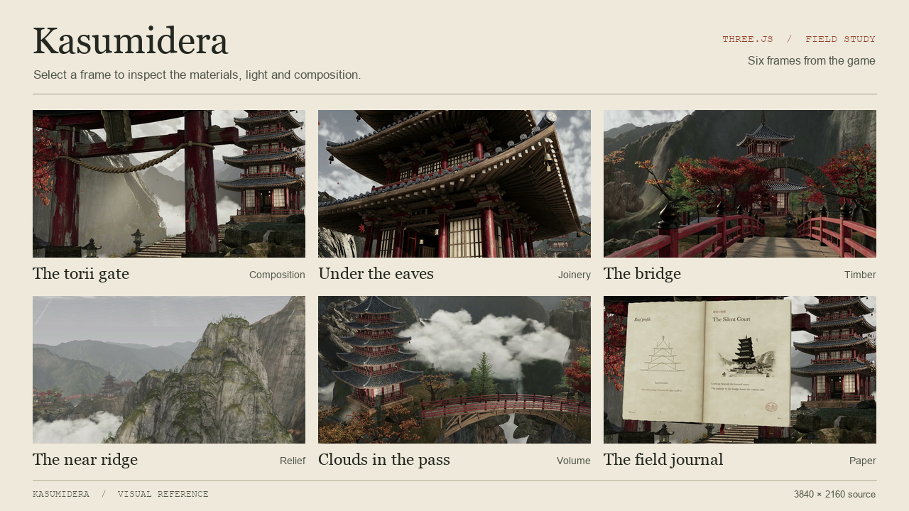

# Kasumidera ultra-realism

A vermilion gate frames a pale valley. Honey-colored boards lead to a dark timber doorway. From across the ravine, the bridge reads as one red stroke. From a step away, you can follow a peg through a board to the beam carrying it. Build for both distances. The painterly quality comes from the arrangement of light, color and silhouettes. The sense of reality comes from what the player can walk around, under and across.

[Inspect six frames from the finished game](demo/index.html). The opening gate, under-eave light, bridge, cliff, cloud bank and journal each demonstrate a different test. [Frame provenance and credits](references/frame-credits.md)

## Establish the shot

1. Choose the player's entrance, destination and route. Block them in with simple meshes. At Kasumidera the torii frames the uphill steps, with the pagoda offset and sky visible around its roof. Keep a strip of bright valley between the middle and far ridges.
2. Save the entrance camera, lens, sun direction, exposure and time. Use separate inspection cameras for the bridge rail, nearest cliff and eaves. Restore the entrance for the playable handoff.
3. Capture the live blockout. For the art target, give that frame to Seedream 5.0 Pro and ask it to preserve the silhouettes, crop and sunlight. Make the color decision explicit. Kasumidera kept worn vermilion, honey-brown hinoki, ochre stone and green fir needles. Keep both the approved reference and a baseline game frame.

## Spend detail where it changes the walk

| If the shot fails here | Make this change first | Check from here |
| --- | --- | --- |
| A roof looks solid from the gate but hollow from below | Model the rafter tails, bearing blocks, tile lips and shadowed gaps. Give cut ends their own grain. | Look up from the doorway and move sideways one bay. |
| The deck looks like a single texture | Model boards, a cambered top, staggered ends, fasteners, bearers and stone seats. Run grain along each timber. | Cross at eye height, look back, then inspect the span from the ravine. |
| A close column looks like glossy plastic | Use a shared wear mask for exposed cedar, chip relief and roughness. Split the highlight where the finish has worn through. | Move a narrow grazing highlight across the front column at 200%. |
| A mountain looks soft despite a sharp map | Cut a coherent ledge and fracture into the nearest silhouette. Use surveyed elevation for the larger range and metre-scale rock detail for the near face. | Move across the ridge, then inspect it facing the light. |
| Red foliage hides the roof | Open a gap around the finial. Fold individual near leaves along their midribs and attach them to twigs. Preserve alpha coverage in the distant canopy. | Check a leaf against bright sky, then return to the entrance. |
| A cloud washes over the rail | Intersect the view ray with a bounded density field and stop at the first opaque surface. Match sun direction to the world. | Strafe past a dark rail with bright cloud behind it. |

Use Poly Haven scan maps at measured scale. Apply albedo, roughness and normal detail in register. Give walk-up hero buildings original geometry when their backs, interiors or undersides are visible. Single-view reconstruction is useful for selected props after a silhouette, backside and scale check. [Construction, surface and atmosphere recipes](references/scene-recipes.md)

## Run a visual review loop

For each Dream Loop review, capture the same entrance, walking-height approach and one diagnostic close-up. For a literal 200% inspection, use camera zoom 2 and update its projection. Size the drawing buffer for the device separately. Keep geometry and text sharp. Budget expensive fog and distant geometry independently.

Compare candidate and baseline at the same sun, lens and exposure. Score **composition /3, lighting /3, materials /3, fine detail /1**. Name one visible defect, change its physical cause, and repeat those frames. Carry a candidate forward when the requested shot improves and the protected view still works. A higher score once favored silver deck boards and blue-gray steps. The creator restored the warm albedo while keeping the geometry and surface relief.

Use the user's target as an acceptance goal. Report what was actually reviewed, what score it received and what remains visible. Walk the route once more for clipped geometry, floating supports, obstructions and unintended camera movement.

## When the brief includes more than the environment

- Start a new scene or redirect an existing pass with the [copy-ready prompts and creator steering](references/director-prompts.md). Trace the original requests in the [creator’s production prompts](references/creator-steering.md), and the 21 saved image-generation inputs in the [model prompt archive](references/generation-prompts.md).
- For the minimal HUD, map, hinged journal, bookmark physics, positional ambience or a 4K walkthrough, use the [interaction and delivery guide](references/play-and-deliver.md).
- Find the project's public asset sources, model references and credits in [References](REFERENCES.md). The skill can be applied to a new setting with locally available assets and tools.
