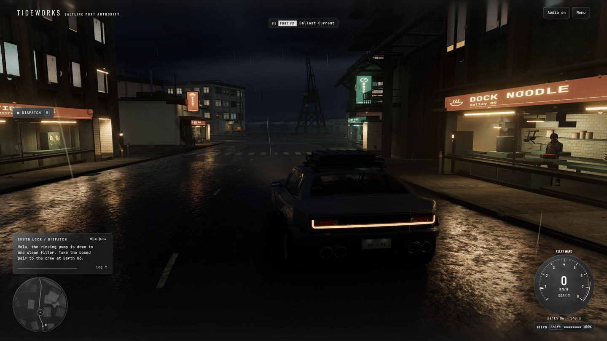

# Retro 3D worlds

Treat retrofuturism as a design brief for a place people use. Tideworks is a working port. Sloped concrete, market awnings, hoist cables, analog instruments and old service vehicles establish its era. New optics, communications gear and the fleet's electric light signatures carry the futuristic part. Set the district's job, construction era and one later retrofit before choosing its colors.



## Match the drive first

Pick a reference view and record where the driver is, what direction they face, lens, camera height, road grade, weather and time of day. Block in the horizon, nearest edge of road, vehicle footprint and the landmark that explains the next turn. Check the road from chase view **and** the cockpit. A gate that reads well from above can hide the exit behind its crosspiece from a driver's seat.

Lay out the route in metres. Give the road surface, colliders, curbs, buildings and landmarks one shared station system. The [coastal route module](scripts/coastal-route.mjs) is the game's survey adapted to import Three.js directly. In a project with `three` installed, copy it next to your scene and use:

```js
import { at, carriageway, coastline, nearest } from './coastal-route.mjs';

const gate = at(coastline.marketLock, 12, 0);
const tireContact = carriageway(coastline.marketLock, 0);
const closest = nearest(tireContact.x, tireContact.z);
```

`at` locates a fixture from a survey station and scaled lateral offset. `carriageway` includes the pavement crown. `nearest` projects X/Z onto the centerline. A station runs from 0 to 1 around the loop. At the lock, the center contact is approximately (−11.720, 1.727, 63.930) m, 57 mm above the uncrowned centerline. Add the loaded radius along the local surface normal to get the hub. Within the inner 14 survey units, divide a desired physical lateral distance by `roadScale(u)` before passing it to either placement function. The sample preserves the original survey through a realignment so adjacent buildings keep their addresses. Use your own survey points for another place.

## Give the environment construction and wear

- **Street and shore.** Give the foreground barrier an actual footprint, interlocking units, top caps, uneven chips and debris at its base. Make repeated castings share tooling and vary their damage. An oversized scratch texture cannot correct a wall that occupies half the intended silhouette.
- **Buildings and interiors.** Model the parapet thickness, window reveals, service access and awning supports that read from a moving car. Put objects just inside visible shop windows. Keep a few large differences between blocks so navigation works in silhouette.
- **Wet materials.** Put aggregate, repairs, drain channels and wheel tracks in surface coordinates. Make the road crown feed water toward gutters and depressions. Wetness changes the width and strength of reflections while raised aggregate still catches grazing light. Match the broad reflection first, then tune the fine normals at driving distance.
- **Light and water.** Put lamps where a fixture can cast the observed light. Use sky and nearby geometry for broad reflections, local probes for the sheltered streets, and reflection updates where motion is visible. A long bright stripe can come from the inspection lamp's beam shape. Isolate the lamp before repainting the pavement. If the far sea breaks into dark flecks, isolate the contact-shadow pass and check the projected water footprint against its sampling radius.
- **Dashboard and sound.** Use an instrument vocabulary that belongs to the vehicle. Let neutral glass panels pick up the world behind them, with one continuous rounded edge and a readable interior over bright sky. Ground the drive in original music, engine load, wet-tire noise and short radio exchanges. Keep source rights with any recordings used.

## Close the reference loop

Save one fixed route station, camera, watch and simulation time. Capture the playable scene and compare it with the reference at the same crop. Rank the largest visible differences in framing, lighting, materials and detail. Change the cause of the first mismatch, then repeat the fixed view **and** drive past it. Keep a second angle to catch fixes that only work in the target frame.

For Tideworks, the review started on character and vehicle choice, moved into a drive, switched to the dashboard and kept the car moving through the operator call. For a 4K60 delivery, check native drawing-buffer size, the encoded resolution and frame cadence, forward progress and the sound mix. Separately profile interactive frame time on the target device. A fixed-step 60 fps export can look smooth even when a player's device misses frames.

On release, inventory runtime bytes by category. Procedural geometry still uses textures, baked lighting, reflection data, character assets and audio. Measure the packaged artifact and identify any bundled older cast or LODs with no runtime users before removing them.
