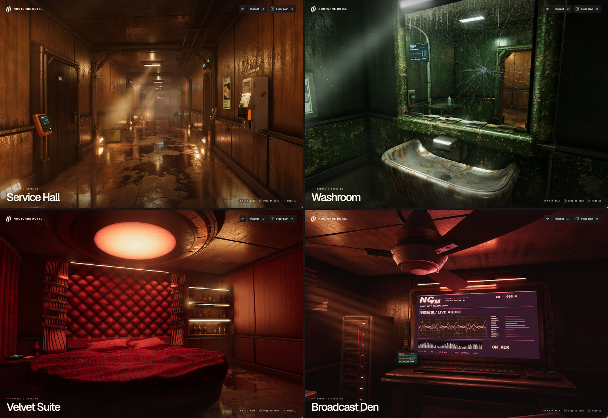

# Ultra-realistic game interiors

Start at the player's eye. Pick one doorway where you can see a light source, the patch it lights, an object touching the floor and a second room beyond. Take two steps sideways. That small move reveals four common problems at once: a flat backdrop, a floating prop, a reflection sliding along the wall and fog painted onto the camera.

These are captures of a playable Three.js floor. Use them to study how four rooms can belong to one building and still be recognizable through a doorway. The hotel’s original visual brief drew on [Fenyr’s four Cyberpunk 2077 views](https://x.com/Fenyr_0nx/status/2120882976997458335). For a new project, lock its own references.

## Build the look in this order

1. **Lock a comparison view.** Save eye position, yaw, pitch, vertical FOV, viewport, render scale and HUD state. Match a doorway, horizon and large prop before tuning surfaces. For an existing scene, hold onto the best playable revision and the user's protected views. A request to retract a held object generally needs a local pose edit.
2. **Walk the blockout.** Use metres and a shared floor plan for collision, navigation and the map. Enter and leave each room on foot. Nocturne used a roughly 3.9 × 24 m hall and a 61° vertical FOV. Match your reference proportions before borrowing those numbers.
3. **Give the room a practical light source.** Start with a fixture visible from the saved view. Shape the spill around its housing and add enough reflected light to reveal the unlit side of nearby objects. In the hotel, the amber hall leads to a green sink, a quilt beneath a red ceiling disc and a desk lit by broadcast equipment. That sequence gives the player directions without adding signs.
4. **Work from shape to surface to air.** Bevel the edge that catches light, vary the finish where people touch it, then add deposits where moisture or wear would collect. Check the surface under grazing light. Add depth-tested shafts, sparse drifting dust and localized haze after the room already reads with the air effects off. [Rendering and material recipes](references/rendering.md)
5. **Make one event hold up in motion.** Choose an interaction the player will actually see. A glass leaves the hand and rests on a counter. A mirror cracks at the point of contact. A shadow crosses the louvers before something offscreen strikes. Drive the pose, contact, material response and sound from the same event. Add character, equipment or HUD work when the brief calls for it. [Characters, interaction, sound and HUD](references/gameplay.md)
6. **Review the running build.** Capture the same view, a short strafe and the relevant action. Score composition /3, lighting /3, materials /3 and detail /1 against the fixed target. Name the most visible discrepancy, change one cause and replay. Keep separate scores for the empty room and first-person view. For a 9/10 request, report the actual result and any remaining defect. Keep the best version if a later pass scores lower. [Prompt sequence, review sheet and capture workflow](references/prompts-and-review.md)

A useful handoff is the playable build, a matched comparison and a short account of what held up while moving. A still can establish composition. A moving camera, a complete gesture or a real retry establishes behavior.
