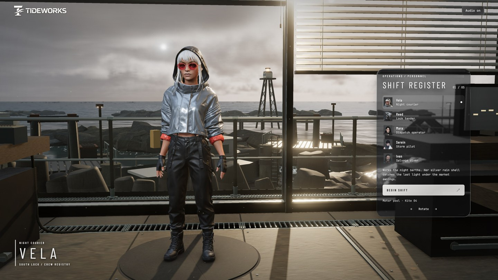

# Image to 3D character

Use this when the input is a character design and the output must survive a close-up, a full-body turn, and animation in the game. Keep the approved image, textured master, rig export, and optimized game file as separate revisions.



## Lock the person before generating geometry

Give the character a role and two design decisions that still read at thumbnail size. In Tideworks, Vela's red lenses sit under a dark hood around white hair. Her cropped silver rain shell catches the port lights. Reed works the lock and has a wedge-shaped mechanical head. For an original design, borrow the reference's tailoring, proportions or material language and give the new person a different face, silhouette and details.

Use the approved portrait as an identity reference for every generation. Tideworks used Seedream 5.0 Pro for the concepts. Make a full-body neutral A-pose with space between wrists and hips and between the boots. Use the same level camera, scale, clothes and lighting for front, left, back and right. Add face, hairline and rear-hair close-ups for review. Trace one asymmetric detail all the way around the sheet. If the zip switches sides or the hood disappears at the back, fix the sheet before spending on a mesh. Feed individual matching views into the corresponding multiview slots where supported. Keep layout text and sheet borders out of the image inputs.

## Make the master and the idle

1. Use the approved views to generate a textured master. Our requested settings were Tripo H3.5 Preview, Ultra, a five-million-triangle target and 4K textures. Those are master targets. Record the actual visible triangles and texture dimensions after export. Keep generation settings and source rights with the working assets.
2. Inspect the unrigged master through 360°. Look under the hood, between the arms and torso, inside the coat and between the boots. Fix welded limbs, duplicate accessories and collapsed profiles before binding. Orbit under a moving light to separate painted highlights from actual surface relief.
3. For a biped, choose Tripo's humanoid rig and Idle animation preset. Export a skinned GLB with its animation. Check for weighted joints and for a clip that actually animates those joints. If the provider returns a lighter mesh during rigging, keep both files and measure them separately.
4. For an existing game skeleton, map joints in the source and target rest poses and check anatomical left and right visually. Transfer the change from each source rest orientation in the target parent's space. Scale hip travel by the same anatomical distance in both rigs. Preserve a natural breathing cycle when removing horizontal locomotion from a standing idle.

## Make the browser copy

The [included converter](scripts/prepare.mjs) and [inspector](scripts/inspect.mjs) come from the game workflow. Use Node.js 22 or newer. From this skill's `scripts` folder, run:

```sh
npm ci
node inspect.mjs master.glb rig-with-idle.glb
node prepare.mjs rig-with-idle.glb character-runtime.glb 300000 --master master.glb
node inspect.mjs character-runtime.glb
```

Use actual file paths. Choose a fresh output path. The triangle target is approximate. The converter favors head- and hand-weighted areas during reduction and keeps texture images at their exported resolution. It reopens the result and checks hierarchy, inverse binds, animation samples and texture contents. Read the report’s weighted triangles, weighted joints, animation names and per-material image sizes. The converter checks for time-varying transforms that affect weighted joints. For a custom-named preset, pass its exact name from `movingSkinClips` with `--idle "Standing Relaxed"`. If that list is empty, return to the animation export or retarget the preset before converting. A static master can be inspected. Conversion requires a rig. If the converter reports an unsupported extension, export a triangulated runtime copy using standard glTF attributes and inspect it again. Keep the original file for authoring. Budget each gameplay use separately: a selector face can occupy hundreds of pixels, while a seated driver may be visible only through glass.

## Put weight on the floor

Preserve glTF bind transforms and place the model with an outer group. Drive the idle on the skeleton and rotate a separate presentation parent slowly around the planted feet. Inspect heel and ball on both boots over one complete cycle, including the loop seam. Use the actual sole surface to set ankle pitch and floor height. Keep toe spring. Apply contact correction to planted feet while the chest and hips continue to move. In Tideworks the contact shadow followed the feet. A shadow offset or a flattened idle can disguise the error in a still and reveal it as soon as the character turns.

Validate the imported result through the real selector. Record front, profile, back and a complete idle with the full sole and floor visible. Switch between characters during loading, rotate by hand, then enter play. Match the selected identity and the runtime model. Deliver a short in-engine turn and the measured master, rig and runtime counts alongside the asset.
