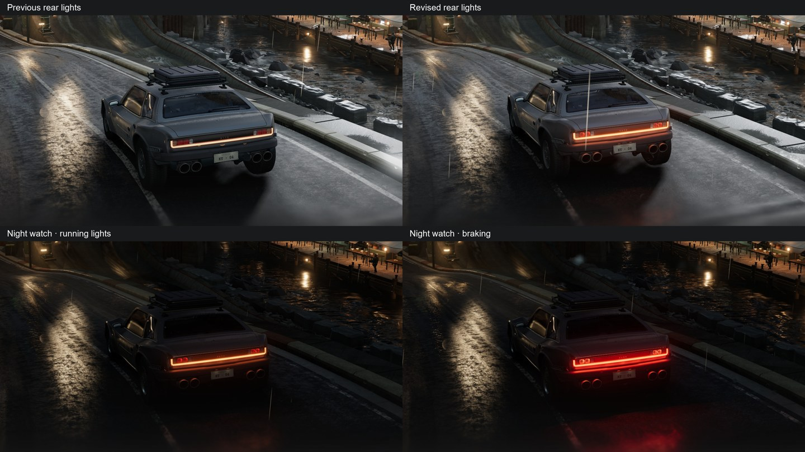

# Procedural 3D cars

Start with a silhouette that reads from the player's usual camera. In Tideworks the Survey Kite is a low coupe with a raised rear deck, Mica is a short city car, Latch has a pickup bed and Parcel has an upright cargo cabin. Each has its own wheelbase, overhangs and roofline. The paint is the last thing that distinguishes them.



## Set the hard points

Capture the existing front and rear from matched cameras. If exploring a revision, produce front and rear three-quarter studies of the **same** design, with consistent wheels, lamps and roof hardware. Compare those with a side elevation. Choose the trim before changing the model. Images guide the geometry and can remain outside the runtime.

Work in metres with +Y up and +Z toward the nose. Record overall length, track, both axle centers, tire radius and width, rocker height, windshield base and roof peak. The [game's four design tables and Survey Kite variant](scripts/fleet-dimensions.mjs) work without dependencies. Each body row holds normalized longitudinal station, actual half-width, center deck height, shoulder height and lower edge. Each axle holds Z, radius, width and **half** track. The wheelMounts helper returns fractions of overall length for Tideworks' normalized vehicle root. Multiply only `x`, `y`, `z`, `r` and `width` by length when building in metres. The rim ratio and side sign are dimensionless. Mica’s front hubs sit at (±0.737, 0.300553, 1.056) m, with 0.307 m tire radius and 0.184 m width. The small drop in hub height accounts for the loaded tire. Use the full radius for an unloaded circular tire.

From this skill’s `scripts` folder, inspect the hatch’s fit before meshing it:

```js
import { designs, wheelMounts } from './fleet-dimensions.mjs';
import { fleetSections } from './body-sections.mjs';

const hatch = designs.find(d => d.id === 'mica');
const frontZ = hatch.axles[1][0];
const section = fleetSections[designs.indexOf(hatch)](frontZ);
const front = wheelMounts(hatch).filter(mount => mount.z > 0);
console.log(section.wheelOpening, front.map(m => [m.x, m.y, m.z].map(v => v * hatch.length)));
```

## Form the panels

1. Interpolate corresponding station values down the car. Use a shape-preserving cubic along the crown and flanks to avoid a bulge at a local extremum. Model the uncut side stamping first. Cut each wheel opening from its lower edge, keeping the panel normals tied to the original surface. The [section sampler](scripts/body-sections.mjs) exposes this construction for the included fleet.
2. Let adjacent bonnet, fender and hatch panels share a surface definition. Split the mesh along the real closure, then add a return lip and a recessed gasket. Hold a broad sky or strip-light reflection across the join. A kink through an unbroken stamping points to a tangent or normal error. A highlight that swallows the shut line points to the edge radius, lens response or post-processing.
3. Give the tires a sidewall and a rounded shoulder. Put the brake caliper on the upright and the rotor and wheel on the spinning hub. Check the tire envelope at full steering lock. Line up the inner wheelhouse and the body opening before adding tread or bolts.
4. Seat the windshield in a surround with thickness, gasket and pillars. Recess the lamps. Give each a dark housing, reflector or projector, emitting element and outer lens. Aim dipped beams at the road from the optical centers. At the rear, separate the lit element, lens border, hatch gap and bumper in geometry. Check tail and brake states at chase distance and compare frames with bloom disabled if the lines smear.

## Make it drive like the same car

Use one steering value for the vehicle, front uprights, dashboard wheel and hand grip. Tideworks damps steering angle and angular velocity through release and reversal. Put the hands on the rim with relaxed wrists, then solve elbows toward stable poles. Check full lock from the driver's camera. For a chase view, update the camera from the same presented vehicle pose. A camera sampling the preceding physics tick can make a smooth turn look jittery.

Share the dimensions and wheel anchors between the player vehicle and traffic. Reduce fitting detail, tread and panel sampling by viewing distance. Keep the roofline, wheel openings and headlamp signature at every level. Batch static fittings by material while keeping steering, wheel spin, lamps and other moving parts independent.

## Review in motion

Use a matching lens, exposure and wheel angle for front, rear and profile comparisons. Then review a wet approach from behind, an oncoming pass and a left–right steering reversal inside the cabin. Watch whether the environment reflection moves across changing panel normals, the tires stay planted and the lamp stays sharp one car length away. Test these through the real vehicle picker and traffic spawner. Report simulation speed separately from the frame rate of an offline render.
